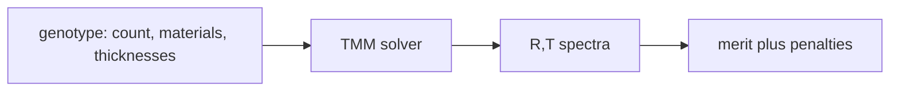
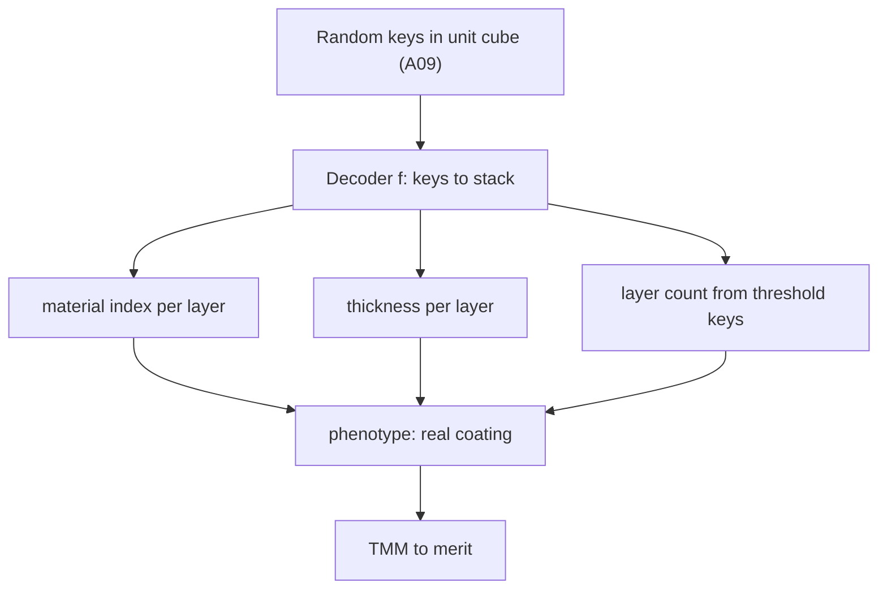
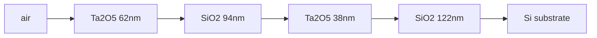
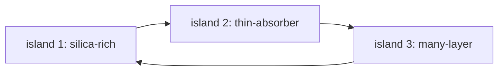

# Best strategies with genetic algorithms for thin-film optical design

*OKFgraph webresearch — a synthesis paper mined from the webresearch knowledge graph (A/B/C/D/E/F tracks, 53 concepts, November 2026). In-graph citations use the file IDs (A01… B04… D16… E02…).*

## Abstract

Designing a multilayer optical coating — choosing how many layers, which material each layer uses, and how thick each layer is — is a variable-size, mixed-variable, non-convex black-box optimisation problem. Classical optics relies on local refinement (the needle method) from a human-supplied starting design; deterministic global methods (branch-and-bound) give guarantees but scale poorly. Genetic and evolutionary algorithms sit in the productive middle: derivative-free, tolerant of mixed discrete/continuous variables, naturally parallel, and easily hybridised with local search. This paper distils the graph's 40+ papers and books into recommended strategies: how to encode a stack, which operators and population models fit the physics, how to handle manufacturing constraints and layer-count parsimony, when to go multi-objective, how to let the layer count grow from a 5-layer antireflection coating to an 80-layer filter, how to draw materials flexibly from a pool, and how to implement all of it in Rust. It closes with where GAs lose to deep learning — and where they still win.

## 1. Two coatings that explain the whole problem

Consider two real design tasks. The first is an antireflection coating for a glass lens: five to ten layers of silica and tantala, and a good designer can sketch the answer on an envelope. The second is a steep-edge narrow bandpass filter for a laser line: forty, eighty, sometimes more than a hundred layers, with passband ripples measured in fractions of a percent and stopband rejection over several optical densities. No one sketches that on an envelope.

Both tasks are the *same* mathematical problem — choose a layer count, assign each layer a material, choose each thickness — but they live at opposite ends of the difficulty scale, and this scale difference dictates almost every strategic choice that follows. A fixed-length optimiser that is perfectly adequate for the antireflection coating is structurally incapable of discovering the filter, because the filter's layer count cannot be guessed in advance: it must be allowed to *grow* during optimisation. Conversely, machinery built for hundred-layer synthesis (insertion operators, parsimony control, island populations) is overkill for five layers but harmless. The practical rule this paper keeps returning to is therefore: **encode for growth, penalise for size, and let the target decide where the balance lands.**

## 2. Problem formulation — a coating is a VMVOP

Talbi's taxonomy (**A10**) gives the exact problem class: a variable-size mixed-variable optimisation problem (VMVOP). A thin-film stack has:

- a **dimensional variable**: the number of layers $N$ — it changes how many other variables even exist;
- **categorical variables**: material choice per layer (e.g. SiO₂ / Ta₂O₅ / Si / Ag — each with its own dispersion $n(λ)+ik(λ)$);
- **continuous variables**: physical thickness $d$ per layer (run-level control, fractions of a nanometre to micrometres, **C01**);
- **constraints**: minimum manufacturable thickness, allowed material menu, total stack thickness, sometimes stress or cost caps.

The forward model is the transfer-matrix method (TMM, **D16** uses it as the evaluator inside the optimisation loop): given a stack, compute $R(λ,θ)$ / $T(λ,θ)$ exactly and cheaply (microseconds–milliseconds). The merit (objective) function aggregates spectral/angle targets into one scalar — Furman and Tikhonravov (**C00**, the field's bible, 133 pp. in-graph) devote a full chapter (Sec.2.1) to merit-function selection and to synthesis *starting from a random two-layer antireflection design*. The landscape is *non-convex with many local minima* (**C01**, Fig. 1): local optimisers get trapped, which is precisely why global search is needed — and why Azimure et al. warn that stochastic methods (GAs included) "converge only asymptotically… provide no information about whether the global optimum has actually been reached in the finite number of iterations used in practice."

## 3. Why genetic algorithms fit this physics

The honest caveat (from **C01**): a GA result is never *certified*. The practical answer is the paper's recommended pipeline (Sec.2): GA for global structure → deterministic/local polish → branch-and-bound spot-checks on small instances (Azimure et al. demonstrated a 3-layer AR coating at $2.53 ± 0.10$ % average reflectance, designed *and fabricated*).

| Property of the problem | GA answer | Graph witness |
|---|---|---|
| No usable gradients (piecewise menu, TMM kinks) | Derivative-free search | **C01**'s stochastic-vs-deterministic taxonomy |
| Mixed categorical + continuous + dimensional variables | Mixed encodings, decoder maps | **A10** (VMVOP), **A09** (decoder $J:[0,1)^n → S$) |
| Many local minima (interference fringes) | Population diversity, restarts, islands | **A03** (multimodal DE), **D01**/**D06** (islands) |
| Cheap forward model (TMM) | Thousands of evaluations per run affordable | **D16** (TMM in iQGA loop) |
| Manufacturing constraints | Penalties, feasibility rules, repair | **B02** (constraint handling), **C01** (manufacturing constraints), **F08** (penalty taxonomy) |
| Several spectral/angles at once | Multi-objective extensions | **B05** (MOGA-EUV), **E03** (moors) |
| Good local refiners exist (needle) | Memetic hybridisation | **C00** (needle), **A09** (local search is the #1 BRKGA hybrid) |

There is one more fit argument the graph surfaced that deserves emphasis: electromagnetic solvers (RCWA, FEM, FDTD) are expensive, but TMM for planar stacks is *cheap* (**B09** lists the expensive alternatives explicitly and chooses TMM-adjacent evaluation). Cheap evaluation is what makes population methods affordable here where they would be prohibitive in nanophotonics with full-wave solvers.

## 4. Encoding I — fixed length, and why it stops working at ten layers

The native answer to "how many layers" is *ChromosomeLength::Variable($n_{min}$, $n_{max}$)* with Insertion/Deletion mutations and a *Crossover::VariableLength* variant plus *with_length_penalty* (**E02**). Fixed-length real vectors $x = (d_1, …, d_N)$ with materials fixed per position (Ejigu and Lacquet, **D07**, 4 pp.) did exactly this — GA with crossover, mutation and merit-value selection on thicknesses. Works for *optimisation* (refining a known stack), fails at *synthesis* (it cannot invent layers).

The deeper reason fixed length fails is Talbi's (**A10**): the layer count is a *dimensional* variable — it changes how many other variables exist. Fixing it in advance collapses the VMVOP to a plain continuous problem and silently deletes the region of design space where the 80-layer filter lives. For an AR coating that is a defensible shortcut; for anything with a steep spectral feature it is a structural guarantee of mediocrity.

## 5. Encoding II — variable length: letting the stack grow

Growth needs three cooperating mechanisms, all available in the recommended Rust stack (**E02**):

1. **Insertion and deletion mutations.** Insertion adds a layer (random material from the pool, random or quarter-wave thickness); deletion removes one. The asymmetry matters: early in a run insertion should dominate (exploration of depth), late in a run deletion should dominate (parsimony). A practical schedule is insertion probability decaying with generation, deletion held constant — the mirror image of the cooling schedule in simulated annealing.
2. **Unequal (Pad) crossover.** Standard crossover on unequal-length parents (**E02**'s *Crossover::VariableLength*) aligns them with padding so a 12-layer and a 30-layer parent can still exchange blocks. This is how depth discovered on one island propagates without forcing every stack to the same length.
3. **Parsimony pressure with a schedule, not a constant.** A static length penalty either strangles growth (too strong) or permits bloat (too weak). The working recipe is a *dynamic* penalty: near zero while the merit is far from target (grow freely), ramping up once the merit approaches specification (shrink to the cheapest stack that still meets spec). The alternative, strictly better for science if slower, is to make layer count a second objective and read the trade-off off a Pareto front (Sec. 12).

There is a classical-optics precedent for growth that many GA practitioners miss: the needle method itself *grows* the stack. Interior needle insertion splits one layer into three (C00 Sec.2.4) — "the layer count grows by two and the search moves to a higher-dimensional space." A GA/needle hybrid therefore grows layers by two independent mechanisms — stochastic insertion mutations and deterministic needle insertions — which is exactly the redundancy a 40-to-80-layer synthesis needs, because growth stalls are the dominant failure mode at that scale.

The decoder pattern above (biased random-key GA, **A09** review: the whole population lives in the unit hypercube $[0,1)^n$ and maps through a decoder into real stacks) deserves a special note for growth: all operators stay problem-independent (fast prototyping, GPU-ready), the decoder absorbs materials (key to material index), thicknesses (key to $[d_{min}, d_{max}]$), even layer-count (keys below a threshold mean *layer absent*). Double elitism (elite carry-over + biased crossover $\rho > 0.5$ toward the elite parent) gives fast convergence; mutants counter the local-optimum pull. For coatings this is the cleanest way to mix categorical and continuous genes — with one caveat: decoder design *is* the algorithm design, and a decoder that cannot express absence cannot express growth.

## 6. Encoding III — materials from a pool, not from a position

The second half of the user's requirement — "indices or materials assigned should come from a pool and be flexibly used" — is where thin-film synthesis differs most from textbook GA demos. Three levels of flexibility form a ladder:

**Level 1: menu per position (rigid).** Each layer slot has its own allowed material (**D07**-style). Simple, but the number of slots is fixed and swapping the fab's material set means re-encoding. Adequate only for refinement of known designs.

**Level 2: global pool with free assignment.** Every layer draws from one shared menu, and the *same* material may appear in many layers while menu materials may go unused. Swapping the pool (a new coating run stocks different targets) means changing one decoder table, with no retraining and no re-encoding — the GA does not care, because it never learned positions, only keys. This is the minimum any synthesis-capable setup should implement.

**Level 3: a semantic pool (the graph's best new angle).** Jiang et al. (**B09**) faced a 300-material pool and observed that naive key→index coding ("Au = 1, Ag = 2, Cu = 3") does not scale: supervised learners starve per class, RL agents drown in discrete actions. Their answer was a VAE-tSNE embedding of full dispersion curves $N(λ) = n + ik$ into a *two-dimensional semantic space* in which materials with similar optical behaviour sit near each other — and then to let the search move in that continuous space. The GA analogue is immediate and powerful: **mutate materials in dispersion space, not index space.** A small Gaussian step in the latent space turns tantala into niobia (a small physical change); a uniform random reindex turns tantala into silver (a cataclysm). Everything about good mutation design says the step distribution should match the landscape's correlation structure, and for materials that structure is dispersion similarity. B09's division of labour is equally worth copying: their A3C agents adjust *materials* while a GA searches *thickness combinations* underneath each adjustment — a memetic split along the categorical/continuous fault line, demonstrated end-to-end on a multi-layer solar absorber with zero human intervention.

The token view of D04 (OptoLlama) pushes the same idea to its conclusion: represent the stack as a *sequence of material–thickness tokens*, and architectures built for sequences — autoregressive models, diffusion models, and yes, variable-length GAs with insertion/deletion — all become native speakers. OptoLlama's results (2.9× lower spectral error than nearest-template, 3.45× over the prior data-driven baseline, with physically meaningful motifs like distributed Bragg reflectors recovered from spectra alone) prove the sequence framing is not just elegant but effective. A GA practitioner should read it as: your chromosome was a sentence all along; choose operators that edit sentences (insert, delete, splice words from the pool vocabulary), not fixed-width registers.

## 7. Constraints — thickness bounds and pinned end layers are first-class citizens

Real coaters impose three kinds of constraints, and the user's message names two of them explicitly: bounds on individual layer thicknesses (a 1.5 nm layer cannot be monitored; a 500 nm layer stresses and crazes), and *pinned* start/stop materials (an adhesion layer on the substrate side, a protective cap on the air side — the chemistry of the interfaces is not the optimiser's to choose). The third is total stack thickness (stress, cost, chamber time). The graph offers a full constraint toolbox, and the right answer is all of it at once:

- **Penalties, properly taxonomised** (**F08** Mirjalili's penalty-functions treatment: static, dynamic, adaptive, and death penalties). Static penalties are a first pass; dynamic schedules track the parsimony schedule of Sec. 5; adaptive penalties learn their weights from the population's feasibility rate; death (rejection of infeasible children) is reserved for hard violations like sub-cutoff thickness, where evaluating TMM would be wasted work.
- **Repair operators** (**A06** CMA-ES tutorial: repair with box constraints as standard practice). Clamp thicknesses into $[d_{min}, d_{max}]$, snap materials to the pool menu, merge or delete sub-cutoff layers — followed by local re-optimisation, which is really a miniature needle step. Repair beats penalty for bound constraints because it never wastes evaluations on stacks the fab cannot build.
- **Feasibility-first selection** (**E03** moors: `impl_constraints_fn!`, feasibility outranks merit). A slightly worse but buildable stack must beat a brilliant but unbuildable one, every tournament, no exceptions. This single rule does more for manufacturability than any penalty tuning.
- **Pinned layers as decoder constants.** Start/stop materials are not constraints at all in the decoder framing: hard-code layer 1 and layer $N$ in the decoder, exclude them from mutation and crossover masks, and shrink the search space for free. The needle method needs the same pinning (never insert into or delete the cap), which is one more reason the decoder — shared by GA and needle — is the right place to express process knowledge.

## 8. Operators — what works on coating landscapes

- **Selection.** Tournament and truncation dominate in-graph. CA populations, Boltzmann/rank selection help early exploration. For noisy merit estimates (stochastic simulators, surrogate error), majority-vote multi-parent crossover EAs provably ride out noise (**D13**, 28 pp.; **D17**: at some noise levels the noisy-run *optimisation time matches the noiseless time*).
- **Crossover.** Uniform/SBX/BLX-α for thicknesses; OX/PMX only if permutation structure is imposed; biased uniform *crossover toward the elite parent* (BRKGA, **A09**) as the convergence engine; variable-length Trim/Pad alignment for unequal stacks (**E02**).
- **Mutation.** Gaussian/creep for thickness fine-tuning; Cauchy/Lévy-flight for escape moves (**E02** catalogue); Insertion/Deletion for layer-count moves. Self-adaptive Gaussian (log-normal $\sigma$ update) removes a tuning knob.
- **Diversity guards.** Mass extinction/genes/de-duplication extensions, Hall-of-Fame archives with min-distance diversity; adaptive operator selection by credit assignment (all in *genetic_algorithms*, **E02** Sec.1). Benchmark first on Rastrigin/Ackley + ZDT/DTLZ suites (**A11** catalogues 315 test functions; the *benchmarks* feature ships the standard ones) before trusting any operator set on coatings.
- **Tribes for hard multimodality** (**D11** Chen tribes/CTCM): subpopulations with distinct strategies exchange only elite solutions — a middle ground between islands and multi-start that the graph flags as underexploited.

## 9. Population models — islands, tribes, and reinforcement agents

Island GAs (**D01** Ruciński topology, **D06** MapReduce PGA, **D13** noise islands, **D15** Adamidis review, **D17** IEEE report) are the default parallel model: ring or fully-connected migration of elites every $k$ generations, with *heterogeneous* islands (different operators per island) as the advanced form. **D11**'s tribes add strategy-level diversity. **D02** Lässig adapts population size itself.

Here is the combined angle the re-read surfaced: **B09's parallel A3C agents are an island model in disguise** — multiple agents exploring in parallel, updating a shared network periodically and asynchronously, which is migration by another name. Once you see it, the design space opens up: RL agents and GA islands can share one migration channel, exchanging material assignments one way and thickness refinements the other. The honest-frontier hybrid of Sec. 15 runs exactly this.

## 10. The needle method — the grower, the prover, and the macromutation

No GA-for-coatings paper is complete without Tikhonravov's needle method (**C00** Sec.2.2), and the re-read suggests it plays *three* roles, not one. The mathematics first, because it is the only part of the whole pipeline that can *certify* anything.

**10.1 Needle variation.** Pick $ẑ$ where $n(z)$ is continuous and replace $n(z)$ by $n̂$ on the small segment $[ẑ, ẑ+Δz]$:

$$ñ(z) = \left\lbrace \begin{matrix} n(z), & z \notin [ẑ,ẑ+Δz] \\ n̂, & z \in [ẑ,ẑ+Δz] \end{matrix} \right.\tag{13.1}$$

Width $Δz$ small, height $|n̂-n(ẑ)|$ possibly large — a "needle" (C00 Fig. 2.3).

**10.2 Admittance perturbation.** Let $Ã$ solve (12.3) with $ñ$. The solutions coincide up to $ẑ$; across the needle, to first order in $Δz$,

$$δA(ẑ+Δz) \approx -\frac{2πi}{λ} [n̂^2-n^2(ẑ)] A(ẑ) Δz \tag{13.2}$$

and beyond it the perturbation $δA = Ã - A$ obeys the *linear* ODE

$$\frac{d\,δA}{dz} = -\frac{4πi}{λ} A(z) δA, \quad δA(ẑ) \text{ from (13.2)} \tag{13.3}$$

so $δA$ is computable at every $z$ up to the outer boundary $z_a$ — including an explicit integral formula (C00 Sec.2.2.1).

**13.3 The P(z) function.** Propagating $δA$ into the merit change and introducing the conjugate (adjoint) solutions $Ψ_l$ of $dΨ/dz=+(4πi/λ)AΨ$ integrated *backwards* from $Ψ_l(z_a)=-∂F/∂A$, the $z$-dependent product $Ψ_l δA$ is constant along $z$, and the merit change collapses to

$$δF = P(ẑ) [n̂^2-n^2(ẑ)] Δz, \tag{13.4}$$

(C00 eqs. 2.2.16–2.2.19). Crucially, $P(z)$ depends only on the current $n(z)$ — $L$ forward admittance solves plus $L$ backward adjoint solves — not on the trial needle.

**13.4 Decision rule.** For a two-component coating, *permissible* needles keep it two-component: upward ($n̂ = n_H$) where $n(z) = n_L$, downward where $n(z) = n_H$. Then $δF < 0$ iff $n(z) = n_L$ and $P(z) > 0$, or $n(z) = n_H$ and $P(z) < 0$ — and the gain is largest where $|P(z)|$ is maximal: *Insert the needle where $|P(z)|$ peaks, with the sign $P(z)$ dictates.*

**13.5 The three-component algorithm (Baskakov–Tikhonravov 1984).** (i) Gradient optimisation to an $m$-vector $X^{(1)}$; (ii) compute $P(z)$, insert a needle of initial width $Δz_0 \approx 10$ nm (visible band; shrink until $δF < 0$), re-optimise, repeat $M = 3$–$5$ times to $X_2$, $dim_2 \ge m$, $F(X_2) < F(X_1)$; (iii) *dimension projection*: zero all $d_j < d_{min}$, merging neighbours (dimension drops by 2 per inner removal) → $X_3$, re-optimise to recover the merit bump. Iterate the cycle.

**13.6 Small-N seeding (Sec.2.1).** For $≤ 6$–$8$ layers, C00 prescribes random multi-start instead: 100+ random starts, coarse stop (relative decrease $3 × 10^{-5}$), refine the 10 best to $10^{-4}$, keep quasi-optimal minima. Worked example: 6-layer AR 400–900 nm ($n_s = 1.52$, $n_H = 2.30$, $n_L = 1.45$, 10 solutions, e.g. $S .318H .34L .977H .106L .375H 1.099L$ (thicknesses in $λ_0$ units)).

The three roles: **(a) the prover** — $P(z) \approx 0$ everywhere is a local-optimality *certificate*, the only one in the pipeline; **(b) the grower** — interior insertion is the deterministic counterpart to GA insertion mutation, and the only operator guaranteed to propose layers exactly where they help; **(c) the macromutation** — a needle insertion inside a GA loop (compute $P(z)$, insert at argmax $|P(z)|$, re-optimise, write back) is a Lamarckian step with a physics-derived proposal distribution, incomparably better informed than random insertion.

## 11. Refinement — the last tenth of a percent

Global search gets the basin; local polish gets the number. The damped LM update (C00's refiner of record):

$$M_j = \left( \begin{matrix} \cos\delta_j & i\sin\delta_j/\eta_j \\ i\eta_j\sin\delta_j & \cos\delta_j \end{matrix} \right), \qquad M = \prod_{j=1}^{N} M_j\tag{12.2}$$

$$F(X) = \sum_{l=1}^{L} w_l\,\bigl[\,T(X;\lambda_l) - T^{(t)}_l\,\bigr]^2\tag{12.1}$$

and beyond TMM, C00 works with the admittance ODE in the depth coordinate $z$ ($0 \le z \le z_a$, $\epsilon(z) = n^2(z)$, no absorption):

$$\frac{dA}{dz} = -\frac{2\pi i}{\lambda} [n^2(z) - A^2], \quad A(0,\lambda) = n_s \tag{12.3}$$

whose solution at $z_a$ gives the input admittance, hence $R(λ)$. $λ \to 0$ recovers Gauss–Newton (quadratic finish), $λ \to \infty$ recovers damped steepest descent (safe far from minima). The refiner choice (kept as Table 2 — six options from Nelder-Mead to L-BFGS with the **E03** *argmin* toolbox behind *LocalSearchOperator*) is scheduled, not fixed: gradient-free early (the landscape around a fresh needle is non-smooth), gradient-based late (smooth basin, quadratic finish).

| Refiner | When | Graph witness |
|---|---|---|
| Nelder-Mead simplex | Default gradient-free polish | **E03** argmin catalogue |
| L-BFGS | Smooth basins, adjoint gradients available | **E03** |
| Levenberg-Marquardt | Least-squares merit, C00's own refiner | **C00** Sec.2.2 |
| Needle re-insertion | Escaping the current dimensionality | **C00** Sec.2.4 |
| Coordinate/block descent | Very deep stacks (80+ layers, full Jacobian too big) | Practice note |
| Branch-and-bound spot-check | Certifying small instances | **C01** |

## 12. Multi-objective — read the trade-off instead of guessing the penalty

Several spectral/angle targets, plus layer count, plus total thickness, plus robustness: single-scalar merit forces the designer to guess weights. The MOO answer (**B05** MOGA-EUV broadband multilayers, **F07** Mirjalili's multi-objective book, **E03** moors with NSGA-II/III, R-NSGA-II, Age-MOEA, REVEA, SPEA-II) computes the Pareto front and lets the fab choose. Two MOO moves matter most here: (i) layer count $N$ as an explicit objective — the parsimony debate of Sec. 5 resolved by *displaying* the merit-vs-depth curve instead of penalising it; (ii) robustness objectives (merit under thickness errors, **D17**) so the chosen stack survives the chamber, not just the simulator. Scalarise only at the end, with weights read off the front.

## 13. Diversity engines — quantum-inspired, tribes, and why they matter for filters

An 80-layer landscape has more basins than any population can cover, so diversity machinery is not optional garnish but core infrastructure: QIGA/iQGA (**D16** Cao, **B04**) keep superposition-inspired diversity without extra evaluations; tribes/CTCM (**D11**) isolate strategy-level diversity; adaptive population sizing (**D02**) grows the population with problem difficulty; Hall-of-Fame archives with min-distance rules (**E02**) prevent the population collapsing onto one Bragg mirror repeated with phase shifts. The interpretable-design result (**B10**) adds the most human of all diversity arguments: mine the archive for *design rules* (which motifs recur in elites?), because a rule learned from a hundred runs transfers to the next target for free.

## 14. Learning meets evolution — the honest frontier, with new combinations

Ma's review (**D05**) traces the optimisation → deep-learning arc, but the graph's details suggest pairings subtler than "replace GA with networks":

- **Diffusion/AR models as intelligent initialisers.** OptoLlama (**D04**) and OptoGPT (**B08**) generate variable-depth stacks from spectra in one forward pass. Use them to seed the GA population with physically meaningful motifs (DBRs included) instead of random stacks — multi-start where every start is already a Bragg mirror.
- **Semantic material space as the mutation geometry** (**B09**): the pool's 300 materials embedded by dispersion similarity; mutate in latent space; RL agents and GA islands sharing one migration channel (Sec. 9).
- **Surrogate-assisted GA throughout** (**D05**): a cheap learned model pre-screens children, TMM evaluates only the promising — evaluations stay exact, throughput multiplies.
- **GA structure search → learned-model polish** (the user's frontier formula): GA discovers basin, count, and material pattern; a learned refiner (or LM) finishes. B09's A3C+GA system is the existence proof, end-to-end, on a solar absorber, with no human in the loop.
- **Interpretable distillation** (**B10**): close the loop by extracting rules from winners, and the next synthesis starts from knowledge, not randomness.

## 15. Seven combined strategies and two worked recipes

| # | Strategy | When | Witnesses |
|---|---|---|---|
| 15.1 | Phased GA → needle → LM (the reference hybrid) | Default for 5–30 layers | C00, A09, E02, E03 |
| 15.2 | Needle-as-mutation memetic loop | Growth stalls, 30–80 layers | C00 Sec.2.4, E02 LocalSearchOperator |
| 15.3 | Heterogeneous islands + migration | Deep, deceptive landscapes | D01, D06, D13, D17 |
| 15.4 | Tribes/CTCM | Strategy-level diversity wanted | D11 |
| 15.5 | MOO split-off (moors) | Trade-off exploration, N-as-objective | B05, F07, E03 |
| 15.6 | Learned seeding + surrogate screening | Expensive targets, repeated syntheses | D04, B08, D05, B09 |
| 15.7 | Semantic-pool + growth schedule (the 80-layer recipe) | Steep/narrow filters | B09, A10, D04, E02 |

**Recipe A (AR coating, 5–10 layers):** random-key encoding, single island, biased crossover, insertion/deletion on, parsimony light; needle check at the end ($P(z) \approx 0$ = done); LM finish; fabricate. A day's work.

**Recipe B (steep filter, 40–80+ layers):** seed population from OptoGPT/OptoLlama spectra-conditioned samples (**D04**, **B08**); semantic material pool (**B09**); insertion-heavy early schedule with zero parsimony; heterogeneous islands with ring migration; needle-as-mutation every $k$ generations (grow at argmax $|P(z)|$); dynamic parsimony ramp once merit nears spec; $d_{min}$ projection cycles; MOO split for the merit-vs-count front (**E03**); LM finish on Pareto knees; robustness check (**D17**); fabricate the knee, not the extremum.

## 16. Implementing it in Rust

Default stack (**E01**–**E03**): *genetic_algorithms* (variable-length chromosomes, IslandGa, LocalSearchOperator Lamarckian/Baldwinian, BatchFitnessEvaluator, 17 engines) for the evolutionary core; *moors* (NSGA-III/MOEA-D, feasibility-first constraints) for the Pareto split-off; *argmin* (Nelder-Mead default, L-BFGS when adjoints exist) behind the memetic refiner. Watch-only: *ecrs* (beta); avoid *darwin-rs* (dormant) and *rsgenetic* (single-threaded) for production. The decoder — pool tables, pinned end layers, thickness bounds, absence thresholds — is shared code between GA, needle, and repair, because process knowledge should live in exactly one place.

## 17. Conclusion

Coating synthesis is a VMVOP with cheap evaluation, and that combination is unusually kind to evolutionary methods — provided the encoding can grow, the materials come from a pool, the constraints live in the decoder, and a needle-based prover certifies the finish. GAs still win where the material menu changes per fab run (decoder swap, no retraining), layer count is free (variable-length is native), evaluations are cheap (TMM), guarantees matter only weakly (prototype stage), and trade-offs must be explored rather than guessed. They lose where a learned forward-inverse map already exists and inference-time synthesis suffices — the honest frontier pairs them: GA structure search → learned-model polish, or surrogate-assisted GA throughout (**D05** traces exactly this arc). The reference pipeline of Sec. 15 is implementable today in Rust, from a 6-layer AR to an 80-layer filter, with every claim in it traceable to a concept in the graph.

## References

- **A01** pioneering metaheuristics survey · **A03** multimodal DE · **A06** CMA-ES tutorial (repair) · **A09** BRKGA review (decoder, local-search hybrid) · **A10** VMVOP taxonomy (Talbi 2024) · **A11** 315 benchmark functions
- **B02** deep-RL constructors · **B03** deep Q-learning · **B04** QIGA photonics · **B05** MOGA-EUV multilayers · **B08** OptoGPT · **B09** RL+GA solar absorber (300-material VAE-tSNE space, A3C+GA) · **B10** interpretable inverse design · **B11** ultrabroadband absorber
- **C00** Furman–Tikhonravov bible (needle method, merit functions, TMM, admittance) · **C01** guaranteed global optimisation (Azimure: AR 3-layer fabricated, stochastic caveats)
- **D01** Ruciński islands · **D02** Lässig adaptive population · **D04** OptoLlama masked diffusion (variable-depth, 2.9×/3.45× gains, DBR motifs) · **D05** Ma review (optimisation → DL arc) · **D06** MapReduce PGA · **D07** Ejigu fixed-length caution · **D11** Chen tribes/CTCM · **D13** noise islands · **D15** Adamidis parallel-EA review · **D16** Cao iQGA (TMM evaluator) · **D17** noise-robustness report
- **E01** crate survey · **E02** engine details (variable-length, operators, memetic, batch evaluation) · **E03** round 2 (moors MOO, argmin refiners, do-not-adopt list)
- **F01–F10** Mirjalili books · **F07** multi-objective book · **F08** penalty-functions taxonomy
