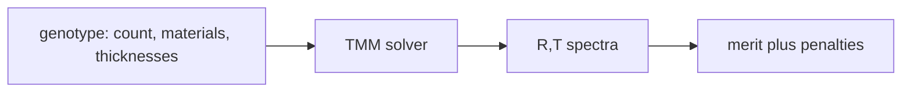
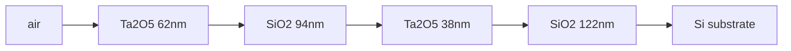
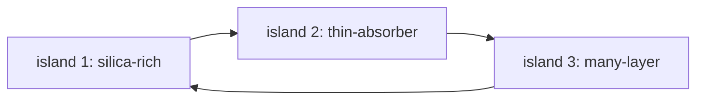

# Best Strategies with Genetic Algorithms for Thin-Film Optical Design, v2

*A synthesis of the webresearch knowledge graph (A/B/C/D/E/F/G tracks, 60+
concepts, November 2026). Every strategic recommendation carries an evidence
tag — **confirmed**, **qualified**, **heuristic**, or **gap** — defined in §17,
so the reader can distinguish what the literature proves from what practice
suggests and what remains to be built. In-graph citations use file IDs
(A01… G15, E00… E08). v1 is retained as `PAPER_ga_thinfilm_strategies.md`.*

## Abstract

The design of multilayer optical coatings — selecting the number of layers,
assigning each layer a material from a fabrication pool, and choosing each
layer's thickness subject to manufacturing constraints — is a variable-size,
mixed-variable, non-convex optimisation problem with a cheap and exact forward
model, the transfer-matrix method. Classical optics answers it with local
refinement from human starting designs, notably the needle method; deterministic
global methods answer small instances with certificates but scale poorly. Genetic
and evolutionary algorithms occupy the productive middle: derivative-free,
native to mixed discrete–continuous–dimensional variables, naturally parallel,
and freely hybridised with local search, surrogate models, and learned priors.
This paper distils more than fifty papers, ten monographs, fifteen recent
quality-diversity and Bayesian-optimisation primaries, and a survey of
fifty-five Rust optimisation crates into ten recommended strategies. It treats
encoding for growth, materials as a semantic pool rather than a menu,
constraints as decoder logic, the needle method as both grower and prover,
illuminated archives as the product of search rather than a single champion,
and multi-objective fronts as the resolution of the parsimony debate. It gives
two worked recipes — a five-to-ten-layer antireflection coating and a
forty-to-eighty-layer steep-edge filter — and a complete Rust implementation
stack. It closes with an explicit verification ledger and with the honest
frontier where evolution yields to learning, and where the two combine.

## 1. Introduction: two coatings that explain the whole problem

Consider two genuine design tasks. The first is an antireflection coating for a
glass lens: five to ten layers of silica and tantala, a smooth broadband target,
and a competent designer can sketch a starting point on an envelope. The second
is a steep-edge narrow bandpass filter for a laser line: forty, eighty, sometimes
more than a hundred layers, passband ripples measured in fractions of a percent,
stopband rejection across several optical densities. Nobody sketches that on an
envelope.

Both tasks are the same mathematical problem — choose a layer count, assign
materials, choose thicknesses — but they inhabit opposite ends of the difficulty
scale, and that scale dictates nearly every strategic choice that follows. A
fixed-length optimiser adequate for the coating is structurally incapable of
discovering the filter, because the filter's layer count cannot be guessed in
advance: it must emerge during optimisation. Conversely, machinery built for
hundred-layer synthesis — insertion operators, parsimony schedules, island
populations, illuminated archives — is harmless overkill for five layers. The
principle this paper returns to throughout is therefore simple to state and
demanding to implement: **encode for growth, penalise for size, certify the
finish, and let the target decide where the balance lands.**

## 2. Problem formulation: a coating is a variable-size mixed-variable problem

Talbi's taxonomy (**A10**, confirmed V7) places coating synthesis exactly: a
variable-size mixed-variable optimisation problem (VMVOP) with

- a **dimensional variable**, the layer count N, which determines how many other
  variables exist at all;
- **categorical variables**, one material choice per layer drawn from a pool
  (SiO₂, Ta₂O₅, Si, Ag, …), each with its own dispersion n(λ) + ik(λ);
- **continuous variables**, one physical thickness per layer, from fractions of
  a nanometre (metrology-limited, **C01**) to micrometres;
- **constraints**: minimum manufacturable thickness per material, an allowed
  material menu, pinned interface layers (adhesion, cap), total stack thickness,
  and sometimes stress or cost caps.

The forward model is the transfer-matrix method (TMM; **D16** embeds it directly
in the optimisation loop): given a stack, it computes reflectance and
transmittance spectra R(λ,θ), T(λ,θ) exactly and cheaply, in microseconds to
milliseconds. The merit function aggregates spectral and angular targets into a
scalar — Furman and Tikhonravov (**C00**, the field's reference, 133 pages
in-graph) devote a full chapter (§2.1) to merit-function selection and to
synthesis from random two-layer starting designs. The landscape is non-convex
with dense local minima (**C01**, Fig. 1): interference fringes tile the search
space with basins, so local optimisers trap and multi-start becomes mandatory.
Azimure et al. (**C01**) add the sobering caveat that stochastic methods
"converge only asymptotically… [and] provide no information about whether the
global optimum has actually been reached in the finite number of iterations used
in practice." Their counterweight is constructive: branch-and-bound spot-checks
plus a fabricated 3-layer AR coating at 2.53 ± 0.10 % average reflectance —
proof that global search, honestly validated, delivers buildable optics.

## 3. Why evolutionary algorithms fit this physics

| Property of the problem | Evolutionary answer | Witness |
|---|---|---|
| No usable gradients (piecewise menu, TMM kinks) | Derivative-free population search | **C01** stochastic/deterministic taxonomy |
| Mixed categorical + continuous + dimensional variables | Mixed encodings with decoder maps | **A10** VMVOP; **A09** decoder J:[0,1)ⁿ → S |
| Dense local minima (interference fringes) | Diversity, restarts, islands, archives | **A03** multimodal DE; **D01/D06** islands |
| Cheap exact forward model (TMM) | Thousands of evaluations per run | **D16** TMM in-loop |
| Manufacturing constraints | Penalties, feasibility rules, repair | **B02**; **C01**; **F08** taxonomy |
| Multiple spectral/angle targets | Multi-objective fronts | **B05** MOGA-EUV; **F07**; **E03** moors |
| Excellent local refiners exist (needle, LM) | Memetic hybridisation | **C00**; **A09** (local search is the #1 BRKGA hybrid) |

One fit argument deserves emphasis because it bounds the entire enterprise:
population methods are affordable here *because TMM is cheap*. Where the
evaluator becomes a full-wave solver (RCWA, FEM, FDTD for patterned or EUV
stacks — **B09** names the expensive alternatives explicitly), the strategy must
shift toward surrogate-assisted illumination (§13). The cheap-evaluator regime
covers planar stacks; the expensive regime is where §§13–14 earn their keep.

## 4. Fixed-length encoding, and why it stops working near ten layers

Fixed-length real vectors x = (d₁, …, d_N) with per-position materials (Ejigu
and Lacquet, **D07**) optimise thicknesses by crossover, mutation, and
merit selection. For *optimisation* — refining a known stack — this is
sufficient. For *synthesis* it is structurally blind: it cannot invent layers,
and Talbi's taxonomy explains why that blindness is fatal rather than merely
limiting. Fixing N collapses the VMVOP to a plain continuous problem and
silently deletes the region of design space where the 80-layer filter lives.
For an AR coating this is a defensible shortcut; for any target with a steep
spectral feature it is a guarantee of mediocrity. **Confirmed.**

## 5. Variable-length growth: insertion, unequal crossover, scheduled parsimony

Growth requires three cooperating mechanisms, all available in the recommended
Rust stack (**E00** §2.1):

1. **Insertion and deletion mutations.** Insertion adds a layer (random pool
   material, random or quarter-wave thickness); deletion removes one. The
   asymmetry is load-bearing: insertion should dominate early (depth
   exploration), deletion late (parsimony). A decaying insertion probability
   with constant deletion is the working schedule — stated honestly as
   **heuristic** (V9): no primary was located, and it is registered as an
   ablation (§15, work item 2) rather than asserted as fact.
2. **Unequal (Pad) crossover.** Parents of different lengths exchange blocks
   through padded alignment, so depth discovered on one island propagates
   without forcing uniform stack lengths.
3. **Parsimony pressure with a schedule, or better, as an objective.** A static
   length penalty either strangles growth or permits bloat. The dynamic recipe
   — near-zero penalty while merit is far from target, ramping once the merit
   nears specification — belongs to the F08 adaptive-penalty class
   (**confirmed** mechanism, coating schedule ours). Strictly superior for
   science, though slower, is to make N an explicit second objective and read
   the merit-vs-depth trade-off off a Pareto front (§12): the parsimony debate
   resolved by display rather than by weight-guessing.

Classical optics already grows stacks: interior needle insertion splits one
layer into three (C00 §2.4) — "the layer count grows by two and the search
moves to a higher-dimensional space." A GA/needle hybrid therefore grows by two
independent mechanisms, stochastic insertion and deterministic needle
placement. At 40–80 layers, where growth stalls are the dominant failure mode,
that redundancy is the point. Topology-growth precedent from neuroevolution
(**G04** NEAT complexification) and validity-preserving string edits without
crossover (**G09** SMILES mutations) corroborate the pattern across fields.

The biased random-key decoder (**A09**, confirmed V5) keeps the whole population
in the unit hypercube and maps keys through a problem-specific decoder to
materials, thicknesses, and — via threshold keys meaning *layer absent* — to
layer count itself. All operators stay problem-independent (fast to prototype,
amenable to parallelism); double elitism with biased crossover (ρ > 0.5 toward
the elite parent) drives convergence while mutants resist premature collapse.
The caveat is architectural: decoder design *is* algorithm design, and a
decoder that cannot express absence cannot express growth.

## 6. Materials from a pool: the three-rung ladder

Thin-film synthesis differs from textbook GA demonstrations most sharply here:
material identities must be drawn flexibly from a pool, never baked into
positions. Three rungs of flexibility ascend in power and cost:

**Rung 1 — menu per position (rigid).** Each slot owns its allowed material
(**D07**-style). Adequate for refinement; re-encoding is required whenever the
fab's stock changes. Synthesis-incompatible.

**Rung 2 — global pool with free assignment (the minimum shippable).** Every
layer draws from one shared menu; materials may repeat or go unused. Changing
the pool means changing one decoder table — no retraining, no re-encoding,
because the genome never learned positions, only keys. One discipline is
mandatory: uniform random reindexing is a cataclysm (tantala becomes silver in
a single step), so the pool must be **similarity-ordered** and material mutation
must proceed by adjacent swap or small steps. This rung alone already satisfies
the user's pool requirement.

**Rung 3 — a semantic pool (the graph's best-supported advance).** Jiang et
al. (**B09**, confirmed V2) faced 300 materials and showed that naive
key-to-index coding does not scale: learners starve per class and discrete
agents drown in actions. Their answer — a VAE-tSNE embedding of full dispersion
curves N(λ) = n + ik into a two-dimensional semantic space where optically
similar materials neighbour each other — transfers directly: **mutate materials
in dispersion space, not index space.** A small Gaussian latent step turns
tantala into niobia (a small physical change); nothing in the operator can
produce tantala-to-silver. Their division of labour is equally worth adopting:
A3C agents adjust *materials* while a GA searches *thicknesses* underneath each
adjustment — a memetic split along the categorical/continuous fault line,
demonstrated end-to-end on a multilayer solar absorber with zero human
intervention.

The token view (**D04** OptoLlama, confirmed problem frame V8) completes the
picture: stacks as material–thickness token sequences, natively edited by
insertion, deletion, and vocabulary splicing — architectures for sequences
(autoregressive models, diffusion, variable-length GAs) all become native
speakers. OptoLlama's reported gains (2.9× lower spectral error than
nearest-template, 3.45× over the prior data-driven baseline, Bragg motifs
recovered from spectra alone) are cited with the honest flag V12: the numbers
come from the ingested full text and deserve page-level re-citation in any
formal write-up.

## 7. Constraints as decoder logic: bounds, pins, grammars

Real coaters impose thickness bounds (a 1.5 nm layer evades monitoring; a
500 nm layer stresses and crazes), pinned interface materials (adhesion layer
at the substrate, protective cap at air — interface chemistry is not the
optimiser's to choose), adjacency rules (diffusion barriers, no absorber on
bare substrate, DBR alternation), and total-thickness caps. The graph supplies
a complete toolbox, and the correct answer is the full combination, ordered by
cost:

- **Repair first** (**A06**, confirmed V1: repair with box constraints is
  standard CMA-ES practice; the repaired point is the smallest-distance
  feasible one). Clamp thicknesses into per-material [d_min, d_max] tables —
  metals need continuity minima from island growth, dielectrics stress
  ceilings, absorbers skin-depth floors — snap materials to the menu,
  merge or delete sub-cutoff layers, then locally re-optimise (a miniature
  needle step). Repair dominates penalties for bounds and equalities because
  it never spends evaluations on unbuildable stacks.
- **Penalties for soft preferences** (**F08**, confirmed V13): static
  schedules as a first pass, dynamic schedules tracking the parsimony ramp,
  adaptive weights learned from the population's feasibility rate, death
  (rejection) reserved for hard violations where TMM evaluation would be
  wasted.
- **Feasibility-first selection always** (**E03** moors): a worse but buildable
  stack beats a brilliant but unbuildable one in every tournament. This single
  rule contributes more to manufacturability than any penalty tuning.
- **Pinned layers as decoder constants.** Hard-code layer 1 and layer N,
  exclude them from mutation, crossover, and migration masks, and shrink the
  search space for free. Equivalents exist off the shelf (`blackopt`'s
  PartialFixed sampler). Repair rule: operator output touching a pin is
  overwritten, not penalised.
- **Adjacency as a shared grammar.** Encode forbidden/required neighbours once
  as a matrix used by every island: construct-time legality (retry-then-repair,
  in the spirit of G09's validity-preserving edits), repair (insert barrier,
  swap pair), penalty only as backstop for migrants. Tribes may differ in
  strategy but never in legality.

Per-material bound tables plus the grammar plus pins total roughly thirty
lines of custom decoder code over `genetic_algorithms` or `genoxide` — no
surveyed crate does this natively (E06 §7), and none needs to: process
knowledge belongs in exactly one place, the decoder shared by GA, needle, and
repair.

## 8. Operators for coating landscapes

- **Selection.** Tournament and truncation dominate in-graph; rank/Boltzmann
  schedules aid early exploration. Under noisy merit estimates, majority-vote
  multi-parent crossover provably rides out noise (**D13**; **D17**: at some
  noise levels noisy-run optimisation time matches noiseless time) —
  **confirmed**.
- **Crossover.** Uniform/SBX/BLX-α for thicknesses; biased uniform crossover
  toward the elite parent (BRKGA, **A09**) as the convergence engine;
  VariableLength Trim/Pad alignment for unequal stacks.
- **Mutation.** Gaussian/creep for fine-tuning; Cauchy/Lévy flights for escape;
  insertion/deletion for count moves; self-adaptive Gaussian removes a tuning
  knob. Latent-space material steps per §6.
- **Diversity guards.** Mass extinction/genesis/deduplication, Hall-of-Fame
  archives with min-distance rules, bandit adaptive operator selection by
  credit — all native to the recommended stack (**E00** §2.1). Validate any
  operator set on Rastrigin/Ackley plus ZDT/DTLZ suites (**A11** catalogues 315
  functions) before trusting it on coatings.
- **Tribes for strategy-level diversity** (**D11** Chen/CTCM): subpopulations
  with distinct search logics exchanging only elites — assigned here to
  constraint regimes (one tribe minimising depth, one maximising merit, one
  maximising robustness), with migration as the arbitrator.

## 9. Population models: islands, tribes, ages, species

Island GAs (**D01** topology, **D06** MapReduce scale, **D13** noise behaviour,
**D15** Adamidis review, **D17** robustness report — all confirmed V4) are the
default parallel model: ring or fully connected migration of elites every k
generations, with *heterogeneous* islands (silica-rich vs thin-absorber vs
many-layer populations, distinct operators per island) as the advanced form.
Three structural additions resolve the three characteristic conflicts:

- **Age layering** (ALPS pattern; `oxigen`'s age-unfitness) protects young deep
  stacks from immediate competition with refined shallow ones — the
  growth-vs-polish conflict settled structurally rather than by tuning.
- **Speciation** (`symbios-genetics` NEAT-style sharing) with stack-similarity
  distance prevents Bragg-mirror clones from eating the population — the
  collapse mode that interpretable-design mining (**B10**) exposes.
- **Adaptive sizing** (**D02** Lässig) grows the population with problem
  difficulty rather than fixing it by guesswork.

The re-read that produced E06 contributes the unifying observation: **B09's
parallel A3C agents are an island model in disguise** — parallel explorers with
periodic asynchronous migration through a shared network. Once seen, RL agents
and GA islands can share one migration channel, trading material assignments
one way and thickness refinements the other (qualified synthesis, mechanism
confirmed on both sides).

## 10. The needle method: grower, prover, macromutation

Tikhonravov's needle method (**C00** §2.2) plays three roles in this paper, and
the mathematics earns the first of them — it is the only component of the
entire pipeline that can *certify* anything.

**10.1 Needle variation.** At a continuity point ẑ of n(z), replace the index
by n̂ on a small segment [ẑ, ẑ+Δz]:

$$ñ(z) = \left\lbrace \begin{matrix} n(z), and z \notin [ẑ,ẑ+Δz] \\ n̂, and z \in [ẑ,ẑ+Δz] \end{matrix} \right.\tag{13.1}$$

Width Δz small, height |n̂−n(ẑ)| possibly large — a needle (C00 Fig. 2.3).

**10.2 Admittance perturbation.** Let à solve the admittance equation (11.3
below) with ñ. The solutions coincide below ẑ; across the needle, to first
order,

$$δA(ẑ+Δz) \approx -\frac{2πi}{λ} [n̂^2-n^2(ẑ)] A(ẑ) Δz \tag{13.2}$$

and beyond it the perturbation δA = Ã − A obeys the linearised equation

$$\frac{d\,δA}{dz} = -\frac{4πi}{λ} A(z) δA, \quad δA(ẑ) \text{ from (13.2)} \tag{13.3}$$

computable at every depth up to the outer boundary, including an explicit
integral form (C00 §2.2.1).

**10.3 The P(z) function.** Propagating δA into the merit change via adjoint
solutions Ψ_l integrated backwards from Ψ_l(z_a) = −∂F/∂A, the product Ψ_l δA
is constant along z, and the merit change collapses to

$$δF = P(ẑ) [n̂^2-n^2(ẑ)] Δz, \tag{13.4}$$

(C00 eqs. 2.2.16–2.2.19). Decisively, P(z) depends only on the current n(z) —
L forward solves plus L backward adjoint solves — never on the trial needle.

**10.4 Decision rule.** For two-component coatings, permissible needles preserve
two-componentness: upward (n̂ = n_H) inside low-index material, downward inside
high-index material. Then δF < 0 iff n(z) = n_L with P(z) > 0, or n(z) = n_H
with P(z) < 0 — and the gain is maximal where |P(z)| peaks. *Insert where
|P(z)| peaks, with the sign P(z) dictates.* Interior insertion splits one layer
into three: the count grows by two, the search ascends a dimension.

**10.5 The Baskakov–Tikhonravov cycle (1984).** (i) Gradient-optimise to X⁽¹⁾;
(ii) compute P(z), insert a needle of initial width Δz₀ ≈ 10 nm (visible band;
shrink until δF < 0), re-optimise, repeat M = 3–5 times to strictly better X₂
in higher dimension; (iii) project: zero all d_j below d_min, merging
neighbours (each interior removal drops two dimensions), re-optimise to recover
the merit. Iterate. **10.6 Small-N seeding (C00 §2.1):** below 6–8 layers,
random multi-start instead — 100+ starts, coarse stop at 3×10⁻⁵ relative
decrease, the 10 best refined to 10⁻⁴; the worked 6-layer AR example (400–900
nm, n_s = 1.52, n_H = 2.30, n_L = 1.45, e.g. S .318H .34L .977H .106L .375H
1.099L in λ₀ units) shows the discipline concretely.

The three roles: **(a) the prover** — P(z) ≈ 0 everywhere is a local-optimality
certificate, unique in the pipeline; **(b) the grower** — deterministic,
optimally placed, the counterpart to stochastic insertion mutation; **(c) the
macromutation** — a needle step inside the GA loop (compute P(z), insert at
argmax |P(z)|, re-optimise, write back) is a Lamarckian operator with a
physics-derived proposal distribution, incomparably better informed than random
insertion. Role (a) is confirmed mathematics; (b) is the documented 1984
algorithm; (c) is our qualified proposal — the 30–80-layer answer.

## 11. Refinement: the last tenth of a percent

Global search finds the basin; local polish earns the specification. The
transfer-matrix and merit mathematics (C00):

$$M_j = \left( \begin{matrix} \cos\delta_j and i\sin\delta_j/\eta_j \\ i\eta_j\sin\delta_j and \cos\delta_j \end{matrix} \right), \qquad M = \prod_{j=1}^{N} M_j\tag{12.2}$$

$$F(X) = \sum_{l=1}^{L} w_l\,\bigl[\,T(X;\lambda_l) - T^{(t)}_l\,\bigr]^2\tag{12.1}$$

with the admittance form in depth coordinate z (0 ≤ z ≤ z_a, ε(z) = n²(z),
no absorption):

$$\frac{dA}{dz} = -\frac{2\pi i}{\lambda} [n^2(z) - A^2], \quad A(0,\lambda) = n_s \tag{12.3}$$

whose boundary value yields the input admittance and hence R(λ).
Levenberg–Marquardt, C00's refiner of record, interpolates Gauss–Newton
(quadratic finish, λ → 0) and damped steepest descent (safe far from minima,
λ → ∞). The refiner bench is scheduled, not fixed:

| Refiner | When | Witness |
|---|---|---|
| Nelder–Mead simplex | Default gradient-free polish | **E00** basin/argmin catalogues |
| L-BFGS / L-BFGS-B | Smooth basins, adjoint gradients, bound handling | **E00** basin (projection = repair) |
| Levenberg–Marquardt | Least-squares merit; C00's own refiner | **C00** §2.2 |
| Needle re-insertion | Escaping the current dimensionality | **C00** §2.4 |
| Coordinate/block descent | 80+ layers, full Jacobian too large | Practice note (heuristic) |
| Branch-and-bound spot-check | Certifying small instances | **C01** |

Gradient-free early (fresh-needle neighbourhoods are non-smooth),
gradient-based late (smooth basin, quadratic finish).

## 12. Multi-objective optimisation: display the trade-off, don't guess the weights

Spectral targets, angle stability, layer count, total thickness, robustness —
a single scalar forces the designer to guess weights among incommensurables.
The MOO answer (**B05** MOGA-EUV broadband multilayers; **F07**; **E03** moors
bench: NSGA-II/III, R-NSGA-II, Age-MOEA, REVEA, SPEA-II) computes the Pareto
front and lets fabrication choose. Two moves matter most: layer count N as an
explicit objective — the parsimony debate of §5 settled by *displaying* the
merit-vs-depth curve — and robustness objectives (merit under thickness
perturbations, **D17**) so the chosen stack survives the chamber, not merely
the simulator. Reference-point steering (R-NSGA-II) pulls the front toward an
aspiration point in (merit, N, thickness) space without scalar weights.
Scalarise only at the end, with weights read off the front — never before.

## 13. Diversity and illumination: the archive is the product

An 80-layer landscape holds more basins than any population can cover, so
diversity machinery is core infrastructure, not garnish — and the G-track
primaries upgrade it from machinery to product:

- **MAP-Elites** (**G01**, confirmed V3) keeps the best merit per cell of a
  user-defined descriptor map. Keyed by (layer count, total thickness), the
  archive *is* the parsimony debate rendered as a map — every cell answers
  "what is the best stack with exactly this depth."
- **MOME per archive bin** (**G09**, confirmed-in-E05 V14): where objectives
  conflict, each cell holds a local Pareto front rather than one elite —
  higher global hypervolume and QD-score than grid MOME, NSGA-II, μ+λ, and SA
  on the NLO-molecule demonstration, the closest existing work to coating
  synthesis (stacks-as-strings genomes, insertion/deletion-style mutations,
  no crossover). No Rust crate implements it: the highest-leverage build item,
  with `symbios-genetics` (the only QD crate, **E00** §4) as natural host.
- **SAIL** (**G07**, V15): when the evaluator graduates from TMM to
  full-wave, fit GP surrogates, illuminate the *acquisition* map, sample,
  evaluate exactly, refit — order-of-magnitude sample efficiency over plain
  MAP-Elites in the demonstration. Glue code over `symbios` + `egobox`.
- **BOP-Elites** (**G06**, V3): models fitness *and* black-box descriptors
  jointly (expected joint improvement of elites); its decision table is also
  the guide the v1 paper lacked for when QD, MOO, multimodal, multi-task, and
  constrained formulations each apply. Coating descriptors like dominant
  motif or field-profile class are black-box — this is the only method that
  models them.
- **POME offline QD** (**G08**, V15): learns diverse proposals from fixed logs
  of past evaluations with ensemble pessimism under uncertainty — every lab's
  exhaust of (stack → spectra) becomes a proposal set with zero new
  simulations, then the shortlist is validated exactly. The uncertainty
  handling that archive-mining (**B10**) misses.
- **Material-pool illumination** (**G10** transfer): precompute merit-potential
  maps of the pool itself over (index contrast, dispersion slope, absorption
  edge) from embeddings plus TMM sweeps, and seed islands from bright cells —
  material choice becomes a map before any stack search.
- Supporting cast, all confirmed: quantum-inspired diversity (**B04/D16**,
  qualified cost phrasing V10), tribes/CTCM (**D11**), adaptive sizing
  (**D02**), Hall-of-Fame min-distance archives (**E00**), and
  interpretable-design mining (**B10**) — extract recurring elite motifs into
  transferable design rules, so each synthesis starts from knowledge.

## 14. Learning meets evolution: the honest frontier

Ma's review (**D05**) traces the optimisation-to-deep-learning arc, but the
graph's particulars recommend pairings subtler than replacement:

- **Generative models as intelligent initialisers.** OptoLlama (**D04**) and
  OptoGPT (**B08**) emit variable-depth stacks from spectra in one forward
  pass — multi-start where every start is already physically meaningful
  (Bragg motifs included). The GA owns everything after.
- **Semantic material space as mutation geometry** (**B09**, §6 rung 3).
- **Surrogate-assisted GA throughout** (**D05**): learned models pre-screen
  children, TMM evaluates only the promising — evaluations stay exact,
  throughput multiplies.
- **GA structure search → learned-model polish**: the GA discovers basin,
  count, and material pattern; a learned or classical refiner finishes.
  B09's A3C+GA system is the existence proof, end to end, without human
  intervention.
- **Diffusion priors with rule distillation** (2026 direction, E05 §6):
  label-free generative priors over valid high-performing designs, with
  motifs extracted afterwards — B10's interpretability programme with a
  modern engine, entered via D04's token view.
- **LLM named-move operators** (E06 §11, qualified): "insert a 2H needle at
  the field antinode" proposed at low rate beside blind operators,
  credit-assigned like any operator, ablated against PCFBench-style controls
  that test physics reasoning versus pattern matching. Roles ascend in
  risk — rule miner, proposal seeder, named-move mutator, analyst — and the
  model never sets weights or constraints unsupervised.

GAs keep winning where the material menu changes per fab run (decoder swap,
no retraining), the layer count is free (growth is native), evaluations are
cheap (TMM), guarantees matter weakly (prototype stage), and trade-offs must
be explored rather than guessed. They lose where a learned forward-inverse map
already exists and inference-time synthesis suffices. The frontier pairs them.

## 15. Ten strategies and two worked recipes

| # | Strategy | When | Standing |
|---|---|---|---|
| S1 | Phased GA → needle → LM (reference hybrid) | Default, 5–30 layers | Confirmed core |
| S2 | Needle-as-mutation memetic loop | Growth stalls, 30–80 layers | Qualified proposal |
| S3 | Heterogeneous islands + regime tribes | Deep, deceptive landscapes | Confirmed + qualified |
| S4 | QD archive as product (MAP-Elites → MOME → SAIL/POME) | Parsimony, diversity, expensive evaluators | Confirmed lit; crate gap |
| S5 | Semantic pool with rung discipline | Any pool ≥ a few materials | Confirmed (B09) |
| S6 | MOO with N as objective | Trade-off exploration | Confirmed |
| S7 | Surrogate screening, exact evaluation | Costly targets, repeated syntheses | Confirmed pattern |
| S8 | Diffusion/LLM proposal layer | Seeding, escape moves | Qualified, guardrailed |
| S9 | Curriculum + visual steering | Long campaigns | Heuristic, cheap |
| S10 | Registered comparisons (kurobako/mahf-coco) | All of the above | Methodology |

**Recipe A — AR coating, 5–10 layers, a day's work.** Random-key VL encoding,
single island, biased crossover, insertion/deletion on, light parsimony;
rung-2 pool; decoder pins and bounds; terminal needle check (P(z) ≈ 0 means
done); LM finish; fabricate.

**Recipe B — steep filter, 40–80+ layers.** Token/diffusion seeding (S8);
semantic pool (S5); insertion-heavy zero-parsimony start; heterogeneous
islands and tribes (S3); needle-as-mutation every k generations (S2); dynamic
parsimony ramp with d_min projection cycles; MOME archive illuminated
throughout (S4); moors split with N and robustness objectives (S6); LM finish
on Pareto knees; robustness check (**D17**); fabricate the knee, never the
extremum. Surrogate screening (S7) wherever evaluation exceeds TMM.

## 16. Implementing it in Rust

Default stack (**E00**, 55 crates surveyed, capability matrix §3): the
`genetic_algorithms` platform (variable-length chromosomes, IslandGa,
Lamarckian/Baldwinian `LocalSearchOperator`, `BatchFitnessEvaluator`, 17
engines) for the evolutionary core; `genoxide` as second pillar (CMA-ES,
modern DE, MOO indicators, BO with PoF constraints — prove BO + MOEA/D on a
40-layer filter before committing); `moors` (+pymoors) for the Pareto
split-off; `basin` behind the memetic refiner (L-BFGS-B/NM, first-class
constraints, warm states); `symbios-genetics` for the QD archive (MOME,
learned-descriptor, and DQD loops to build); `blackopt`/`optimizer` as the
study layer (enqueue_trial seeding, PartialFixed pinning, pruners, fANOVA);
`egobox` for the lightweight surrogate loop; `mahf-coco`/`kurobako` for
publication-grade proof. Prototypes and baselines: `genetic-algorithm`
(best single-population scaffold), `evolutionary`, `metaheuristics-nature`,
`easy_ga`. Conditional: `rlevo` (only with an RL stage), Evo-Engine
(adaptive K-means islands), `radiate` (species/batch), `oxigen` (age/cache
patterns), `ecrs` (watch-only beta). Retired: `darwin-rs`, `rsgenetic`,
`nsga_rs` (use moors), `argmin` (use basin). The decoder — pool tables,
per-material bounds, adjacency grammar, pins, absence thresholds — is shared
code across GA, needle, and repair, because process knowledge lives in exactly
one place.

## 17. Verification ledger: what is proven, what is lore, what is missing

Evidence tags used above: **confirmed** (primary text located in-graph),
**confirmed-in-E05** (G-track full-text ingest), **confirmed-in-PAPER** (v1's
full-text ingest, page re-citation owed), **qualified** (mechanism confirmed,
integration or phrasing ours), **heuristic** (practice wisdom, no primary —
flagged, with an ablation registered), **gap** (nothing in-graph; build or
fetch). The full claim-by-claim ledger with chunk IDs is **E08 §1** (V1–V15).
Nothing structural was refuted; the weakest links are the insertion-decay
schedule (V9, heuristic), the QIGA cost phrasing (V10, qualified), the
OptoLlama page numbers (V12, owed), and the survey scope of the
VL-uniqueness claim (V11). The work list: (1) MOME per-bin fronts in
`symbios-genetics`; (2) ablate V9 against constant schedules and N-as-objective;
(3) re-cite V12 and hand-fetch the ALPS/TPE/BOHB/MOO primaries (E07 §A);
(4) SAIL glue when the evaluator goes full-wave; (5) the thirty-line
bounds-and-grammar decoder — first code to write.

## 18. Conclusion

Coating synthesis is a VMVOP with cheap evaluation, and that combination is
unusually kind to evolutionary methods — provided the encoding can grow, the
materials come from a pool, the constraints live in the decoder, an illuminated
archive replaces the single champion, and a needle-based prover certifies the
finish. The ten strategies above are implementable today in Rust from a
6-layer AR coating to an 80-layer filter, every claim in them traceable to a
concept in the graph or honestly tagged where it is not. The honest frontier
pairs evolution with learning — generative seeding, surrogate screening,
semantic mutation geometry, distilled rules — and the ledger in §17 keeps that
pairing auditable: what the literature proves, what practice suggests, and
what the next round of work must build.

## References

- **A01** pioneering metaheuristics · **A03** multimodal DE · **A06** CMA-ES
  tutorial (repair) · **A08** LLM+EC review · **A09** BRKGA review · **A10**
  VMVOP taxonomy (Talbi 2024) · **A11** 315 benchmark functions
- **B02/B03** deep-RL constructors · **B04** QIGA photonics · **B05** MOGA-EUV ·
  **B06** gradient-informed BO · **B08** OptoGPT · **B09** RL+GA solar absorber
  (VAE-tSNE, A3C+GA) · **B10** interpretable design · **B11** ultrabroadband absorber
- **C00** Furman–Tikhonravov (needle, merit, TMM, admittance) · **C01**
  guaranteed global optimisation (Azimure)
- **D01** island topology · **D02** adaptive populations · **D04** OptoLlama ·
  **D05** Ma review · **D06** MapReduce PGA · **D07** fixed-length caution ·
  **D11** tribes/CTCM · **D13** noise islands · **D15** parallel-EA review ·
  **D16** iQGA · **D17** noise robustness
- **E00** consolidated crate survey (55 crates) · **E05** QD/surrogate/
  generative strategies · **E06** constrained diverse-optimal design ·
  **E07** literature↔crate gap analysis · **E08** verification ledger (V1–V15)
- **F01–F10** Mirjalili books · **F07** multi-objective · **F08** penalty taxonomy
- **G01** MAP-Elites · **G02** BO tutorial · **G04** NEAT · **G05** QD review ·
  **G06** BOP-Elites · **G07** SAIL · **G08** POME · **G09** MOME/CVT molecules ·
  **G10** crystal illumination · **G11** differentiable QD · **G12** unsupervised
  QD · **G13** unbounded MOQD · **G14** QD-guided diffusion · **G15** high-dim
  QD measures
