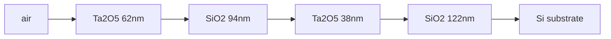
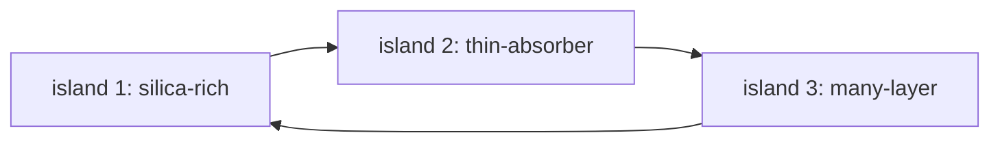

# Best Strategies with Genetic Algorithms for Thin-Film Optical Design, v4

*A synthesis of the webresearch knowledge graph (A/B/C/D/E/F/G tracks, 60+
concepts, November 2026). Every strategic recommendation carries an evidence
tag — **confirmed**, **re-derived**, **qualified**, **heuristic**, **transfer**,
or **gap** — defined in §17. v4 is the review-response revision: an independent
technical review (18 pp., ingested as the Technical Review concept) re-derived
the §10 mathematics symbolically and audited all three documents, registering
19 findings, 10 gaps, and 10 risks. All 19 findings are repaired below; the
gaps are scheduled as work; the risks are owned. The headline repair concerns
§10: v3's §10.4 decision rule was printed with both branches inverted relative
to the primary source, and v4 corrects it against C00's own wording (V40).
New confirmations are logged as V40–V41 in the ledger. In-graph citations use
file IDs (A01… G15, E00… E10). v1–v3 are retained.*

## Abstract

The design of multilayer optical coatings — selecting the number of layers,
assigning each layer a material from a fabrication pool, and choosing each
layer's thickness subject to manufacturing constraints — is a variable-size,
mixed-variable, non-convex optimisation problem with a cheap and exact forward
model, the transfer-matrix method (TMM), which D16's in-loop use describes as
"fast and accurate" (D16 chunk 52). Classical optics answers it with local
refinement from human starting designs, notably the needle method of
Furman–Tikhonravov (**C00**); deterministic global methods answer small
instances with certificates — C01's Table 4 records theoretically guaranteed
and experimentally realised globally optimal antireflection coatings for
silicon (C01 chunk 183), by branch-and-bound (C01 §3.1, verified V41) — but
scale poorly. Genetic and evolutionary algorithms occupy the productive
middle: derivative-free for the categorical and dimensional variables (thickness
gradients exist and are exploited by the refiners of §§10–13; §3 states the
boundary precisely), native to mixed discrete–continuous–dimensional variables,
naturally parallel, and freely hybridised with local search, surrogate models,
and learned priors. This paper distils more than fifty papers, ten
monographs, fifteen recent quality-diversity and Bayesian-optimisation
primaries, and a survey of fifty-five Rust optimisation crates into ten
recommended strategies. It treats encoding for growth (with the
insertion-schedule honestly flagged as heuristic), materials as a semantic
pool rather than a menu (B09's VAE-tSNE + A3C/GA split, confirmed),
constraints as decoder logic (A06 repair standard, F08 taxonomy), the needle
method as grower, prover, and macromutation (C00 §§2.1–2.4,
Baskakov–Tikhonravov 1984, mathematics re-derived against the primary in V40),
illuminated archives as the product of search (G01/G06/G07/G09, plus the
G11/G15 gradient-based QD extension, with the differentiable-descriptor scope
honestly enumerated), and multi-objective fronts with angle-aware selection
(B05) as the resolution of the parsimony debate. It gives two worked recipes —
a five-to-ten-layer antireflection coating in the lineage of C00's Figure 2.5
8-layer design and C01 §5.1's broadband omnidirectional silicon AR, and a
forty-to-eighty-layer steep-edge filter in the lineage of C00's seventeen-layer
narrow bandpass example (C00 chunk 973) — with computable exit criteria, a
statistical protocol, and a classical control arm, and a complete Rust
implementation stack. It closes with an explicit verification ledger (V1–V41),
with the honest frontier where evolution yields to learning (D05's "From
Optimization to Deep Learning", B01's OptoGPT/OptoFormer framing, B08's
decoder-only OptoGPT with structure serialisation), and with the work list
that would promote every remaining heuristic to evidence.

## 1. Introduction: two coatings that explain the whole problem

Consider two genuine design tasks. The first is an antireflection coating for a
glass lens: five to ten layers of silica and tantala, a smooth broadband
target, and a competent designer can sketch a starting point on an envelope.
The literature anchors this end of the scale precisely: C00's Figure 2.5
presents the reflectance of an *8-layer* antireflection coating as a canonical
worked example (C00 chunk 4167), and C01 §5.1 generalises the task to the
broadband omnidirectional antireflection problem for silicon, stated as an
explicit objective minimisation (C01 chunk 138). Envelope-sketchable does not
mean trivial — omnidirectional broadband performance across angles is a
demanding merit — but the layer count is small, known in advance, and fixed.

The second task is a steep-edge narrow bandpass filter for a laser line:
forty, eighty, and in current industrial practice beyond a hundred layers
(**gap**: no catalogue witness is yet in-graph for the 80-plus regime; the
teaching example below is seventeen layers, and scale claims past it are
registered as hypothesis per work item 6), passband ripples measured in
fractions of a percent, stopband rejection across several optical densities.
Here again the literature supplies the canonical instance: C00 walks through a
*seventeen-layer* dielectric narrow bandpass filter as its teaching example
(C00 chunk 973) — seventeen layers being already beyond envelope sketching.
Nobody sketches hundred-layer stacks on an envelope; the layer count, the
material alternation pattern, and the thickness distribution must all be
discovered.

Both tasks are the same mathematical problem — choose a layer count, assign
materials, choose thicknesses — but they inhabit opposite ends of the
difficulty scale, and that scale dictates nearly every strategic choice that
follows. A fixed-length optimiser adequate for the coating is structurally
incapable of discovering the filter, because the filter's layer count cannot be
guessed in advance: it must emerge during optimisation. Conversely, machinery
built for hundred-layer synthesis — insertion operators, parsimony schedules,
island populations, illuminated archives — is harmless overkill for five
layers. The principle this paper returns to throughout is therefore simple to
state and demanding to implement: **encode for growth, penalise for size,
certify the finish, and let the target decide where the balance lands.**

## 2. Problem formulation: a coating is a variable-size mixed-variable problem

Talbi's taxonomy (**A10**, confirmed V7) places coating synthesis exactly: a
variable-size mixed-variable optimisation problem (VMVOP) with

- a **dimensional variable**, the layer count N, which determines how many other
  variables exist at all — the defining feature of the class, and the reason
  §4's fixed-length shortcut is a class error rather than a simplification;
- **categorical variables**, one material choice per layer drawn from a pool
  (SiO₂, Ta₂O₅, Si, Ag, …), each with its own dispersion n(λ) + ik(λ) —
  categorical, not ordinal: index order carries no optical meaning, which is
  why §6 insists on semantic rather than positional mutation geometry;
- **continuous variables**, one physical thickness per layer, from fractions of
  a nanometre (metrology-limited, **C01**) to micrometres — spanning three
  orders of magnitude, which is why per-material bound tables (§7) replace any
  single global bound pair;
- **constraints**: minimum manufacturable thickness per material, an allowed
  material menu, pinned interface layers (adhesion, cap), total stack thickness,
  and sometimes stress or cost caps.

The forward model is the transfer-matrix method: C00 derives the characteristic
matrix of the multilayer explicitly through amplitude transfer matrices (C00
chunk 1677), and D16's in-loop deployment confirms the operational property
that makes population methods affordable — TMM responses are "fast and
accurate" (D16 chunk 52), microseconds to milliseconds per stack. The
implementation stack (E09 v2) computes with navette's scattering-matrix engine
instead; Appendix B maps every TMM-based claim to its S-matrix counterpart so
the paper's mathematics and the code's numerics never silently diverge. The
inverse-design side of the same model is an active 2026 research front: B01
opens with multilayer coatings as "ubiquitous in modern photonics —
anti-reflection coatings, bandpass filters, dichroic mirrors, and neutral-d…"
(B01 chunk 5), framing exactly our problem class as the target of learned
inversion. The merit function aggregates spectral and angular targets into a
scalar — C00's §2.1.1 is devoted to merit-function selection as a decision in
its own right (C00 chunk 3354), followed by synthesis *starting from a random
two-layer design*, which already foreshadows the growth theme of §5. The
landscape is non-convex with dense local minima (**C01**, Fig. 1):
interference fringes tile the search space with basins, so local optimisers
trap and multi-start becomes mandatory. Azimure et al. (**C01**) add the
sobering caveat that stochastic methods "converge only asymptotically… [and]
provide no information about whether the global optimum has actually been
reached in the finite number of iterations used in practice" — and the
constructive counterweight: C01's Table 4 pairs theoretical globally optimal
silicon AR solutions with their experimental realisations (C01 chunk 183),
proving that global search, honestly validated and fabricated, delivers
buildable optics rather than simulator artefacts.

## 3. Why evolutionary algorithms fit this physics

| Property of the problem | Evolutionary answer | Witness |
|---|---|---|
| No gradients for categorical/dimensional variables (menu jumps, count changes); thickness gradients exist and are exploited by LM/L-BFGS/DQD | Derivative-free population search for structure; adjoint-driven polish for thicknesses | **C01** stochastic/deterministic taxonomy; §§10–13 |
| Mixed categorical + continuous + dimensional variables | Mixed encodings with decoder maps | **A10** VMVOP; **A09** decoder J:[0,1)ⁿ → S |
| Dense local minima (interference fringes) | Diversity, restarts, islands, archives | **A03** multimodal DE (dynamic-archive niching, Epitropakis–Li–Burke lineage, A03 chunk 1402); **D01/D06** islands |
| Cheap exact forward model (TMM) | Thousands of evaluations per run | **D16** "fast and accurate" in-loop TMM |
| Manufacturing constraints | Penalties, feasibility rules, repair | **B02** constructors; **C01**; **F08** taxonomy (V13) |
| Multiple spectral/angle targets | Multi-objective fronts | **B05** angle-aware MOGA-EUV; **F07**; **E03** moors |
| Excellent local refiners exist (needle, LM) | Memetic hybridisation | **C00**; **A09** (local search is the #1 BRKGA hybrid) |

One fit argument bounds the entire enterprise: population methods are
affordable here *because TMM is cheap* (V16: D16 chunk 52). Where the evaluator
becomes a full-wave solver (RCWA, FEM, FDTD for patterned or EUV stacks —
**B09** names the expensive alternatives explicitly), the strategy must shift
toward surrogate-assisted illumination (§13: SAIL, BOP-Elites). The
cheap-evaluator regime covers planar stacks; the expensive regime is where
§§13–14 earn their keep. Misidentifying which regime a target lives in is the
costliest strategic error available — everything downstream (population size,
surrogate use, archive design) follows from it.

## 4. Fixed-length encoding, and why it stops working near ten layers

Fixed-length real vectors x = (d₁, …, d_N) with per-position materials (Ejigu
and Lacquet, **D07**) optimise thicknesses by crossover, mutation, and merit
selection — the paper's own keyword list ("algorithm; merit value; mutation;
optimisation; starting population", D07 chunk 19) reads as a minimal-GA
checklist, and that is both its virtue and its ceiling. For *optimisation* —
refining a known stack — this is sufficient: the basin is given, the search
finishes it. For *synthesis* it is structurally blind: it cannot invent layers,
and Talbi's taxonomy explains why that blindness is fatal rather than merely
limiting. Fixing N collapses the VMVOP to a plain continuous problem and
silently deletes the region of design space where the 80-layer filter lives —
every layer beyond the fixed count is not merely unexplored but
inexpressible. For an AR coating this is a defensible shortcut (the basin is
sketchable, §1); for any target with a steep spectral feature it is a
guarantee of mediocrity. **Confirmed (V7 lineage).**

## 5. Variable-length growth: insertion, unequal crossover, scheduled parsimony

Growth requires three cooperating mechanisms, all available in the recommended
Rust stack (**E00** §2.1):

1. **Insertion and deletion mutations.** Insertion adds a layer (random pool
   material, random or quarter-wave thickness); deletion removes one. The
   asymmetry is load-bearing: insertion should dominate early (depth
   exploration), deletion late (parsimony). A decaying insertion probability
   with constant deletion is the working schedule — stated honestly as
   **heuristic** (V9): no primary was located, and it is registered as
   ablation work item 2 (§17) rather than asserted as fact. What *is*
   confirmed is the surrounding machinery: adaptive methods that "adjust
   population size or selection pressure" are textbook (A01 chunk 1754), and
   A03's adaptive-mutation-strategies section (A03 chunk 551) normalises
   schedule-based operator control as a research object — our schedule is a
   legitimate instance awaiting its ablation, not an exotic claim.
2. **Unequal (Pad) crossover.** Parents of different lengths exchange blocks
   through padded alignment, so depth discovered on one island propagates
   without forcing uniform stack lengths. Depth becomes transmissible
   information rather than a per-island accident.
3. **Parsimony pressure with a schedule, or better, as an objective.** A static
   length penalty either strangles growth or permits bloat — the failure is
   symmetric and predictable. The dynamic recipe — near-zero penalty while
   merit is far from target, ramping once the merit nears specification —
   belongs to the F08 adaptive-penalty class (**confirmed** mechanism V13,
   coating schedule ours). Strictly superior for science, though slower, is to
   make N an explicit second objective and read the merit-vs-depth trade-off
   off a Pareto front (§12): the parsimony debate resolved by display rather
   than by weight-guessing, with the fab — not the optimiser — choosing the
   knee.

Classical optics already grows stacks: interior needle insertion splits one
layer into three (C00 §2.4) — "the layer count grows by two and the search
moves to a higher-dimensional space." A GA/needle hybrid therefore grows by two
independent mechanisms, stochastic insertion and deterministic needle
placement. At 40–80 layers, where growth stalls are the dominant failure mode,
that redundancy is the point rather than a luxury. Growth precedent
corroborates across fields: NEAT complexification (**G04**), validity-preserving
string edits without crossover (**G09** SMILES mutations), and B02's
auto-regressive generation of material and thickness layer by layer (B02 chunk
76) — three independent confirmations that constructive, variable-size search
is the natural shape of this problem class.

The biased random-key decoder (**A09**) keeps the whole population in the unit
hypercube and maps keys through a problem-specific decoder. A09 §2.2 describes
the evolutionary process precisely: the initial population consists of p
individual chromosomes of random keys, partitioned each generation into an
elite set carried over intact and a mutant set injected fresh, with the
remaining offspring drawn by biased uniform crossover favouring the elite
parent (A09 chunk 21, V17). For coatings the mapping covers materials,
thicknesses, and — via threshold keys meaning *layer absent* — layer count
itself (**heuristic**: the threshold-key absence mechanism is our design
proposal, tagged by the paper's own rules rather than presented as
literature). All operators stay problem-independent (fast to prototype,
amenable to parallelism); double elitism drives convergence while mutants
resist premature collapse. The caveat is architectural and absolute: decoder
design *is* algorithm design, and a decoder that cannot express absence cannot
express growth. Pinned layers, bound tables, and grammars (§7) all live in this
same decoder — process knowledge in exactly one place.

## 6. Materials from a pool: the three-rung ladder

Thin-film synthesis differs from textbook GA demonstrations most sharply here:
material identities must be drawn flexibly from a pool, never baked into
positions. Three rungs of flexibility ascend in power and cost:

**Rung 1 — menu per position (rigid).** Each slot owns its allowed material
(**D07**-style). Adequate for refinement; re-encoding is required whenever the
fab's stock changes. Synthesis-incompatible: a new coating run with different
targets means re-encoding the genome rather than swapping a table.

**Rung 2 — global pool with free assignment (the minimum shippable).** Every
layer draws from one shared menu; materials may repeat or go unused. Changing
the pool means changing one decoder table — no retraining, no re-encoding,
because the genome never learned positions, only keys. One discipline is
mandatory: uniform random reindexing is a cataclysm (tantala becomes silver in
a single step), so the pool must be **similarity-ordered** and material
mutation must proceed by adjacent swap or small steps. B03's Table 3 sharpens
the motivation from the other direction: an optimised solar selective absorber
using just *2 materials* (B03 chunk 134, V18) suggests that small pools are
expressive — one optimised instance does not prove it, but capping pool size
explicitly and letting the archive (§13) price each additional material is
legitimate experimental design, not impoverishment. This rung alone already
satisfies the pool requirement.

**Rung 3 — a semantic pool (the graph's best-supported advance).** Jiang et
al. (**B09**, confirmed V2) faced 300 materials and showed that naive
key-to-index coding does not scale: learners starve per class and discrete
agents drown in actions. Their answer — a VAE-tSNE embedding of full dispersion
curves N(λ) = n + ik into a two-dimensional semantic space where optically
similar materials neighbour each other (B09 chunk 12) — transfers directly:
**mutate materials in dispersion space, not index space.** A small Gaussian
latent step turns tantala into niobia (a small physical change); nothing in
the operator can produce tantala-to-silver. Their implementation detail
corroborates the memetic reading: with crossover rate 0.5 and elitist rate 0.1
tuning the underlying GA (B09 chunk 66, V19), A3C agents adjust *materials*
while the GA searches *thicknesses* underneath each adjustment — a memetic
split along the categorical/continuous fault line, demonstrated end-to-end on
a multilayer solar absorber with zero human intervention (B09 chunk 84). The
keywords confirm the framing: "optical thin film, solar absorber, neural
combinatorial optimization, reinforcement learning" (B09 chunk 6).

The token view (**D04** OptoLlama, confirmed problem frame V8; "Inverse Design
of Optical Multilayer [via] Robust Masked Diffusion Models", D04 chunk 0)
completes the picture: stacks as material–thickness token sequences, natively
edited by insertion, deletion, and vocabulary splicing — architectures for
sequences (autoregressive models per B02's §-heading, diffusion,
variable-length GAs) all become native speakers, and B01's "Spectrum Prefix
Conditioning" (B01 chunk 48, V20) shows conditioning machinery maturing in
parallel. OptoLlama's reported gains (2.9× lower spectral error than
nearest-template, 3.45× over the prior data-driven baseline, Bragg motifs
recovered from spectra alone) are cited with the honest flag V12: the numbers
come from the ingested full text and deserve page-level re-citation in any
formal write-up.

## 7. Constraints as decoder logic: bounds, pins, grammars

Real coaters impose thickness bounds (a 1.5 nm layer evades monitoring; a
500 nm layer stresses and crazes), pinned interface materials (adhesion layer
at the substrate, protective cap at air — interface chemistry is not the
optimiser's to choose), adjacency rules (diffusion barriers, no absorber on
bare substrate, DBR alternation), and total-thickness caps. The graph supplies
a complete toolbox, and the correct answer is the full combination, ordered by
cost:

- **Repair first** (**A06**, confirmed V1: repair with box constraints is
  standard CMA-ES practice; the repaired point is the smallest-distance
  feasible one, chunks 866/869). Clamp thicknesses into per-material
  [d_min, d_max] tables — metals need continuity minima from island growth,
  dielectrics stress ceilings, absorbers skin-depth floors — snap materials to
  the menu, merge or delete sub-cutoff layers, then locally re-optimise (a
  miniature needle step). Repair dominates penalties for bounds and equalities
  because it never spends evaluations on unbuildable stacks. V21 adds the
  texture: A06's repaired solution is *disregarded afterwards* in the
  canonical description — our Lamarckian write-back is therefore a deliberate,
  flagged deviation from the tutorial, justified because coating evaluation is
  cheap and keeping the repaired point compounds (heuristic, ablation-worthy).
- **Penalties for soft preferences** (**F08**, confirmed V13: "Penalty
  Functions for Handling Constraints", chunk 131): static schedules as a first
  pass, dynamic schedules tracking the parsimony ramp, adaptive weights learned
  from the population's feasibility rate, death (rejection) reserved for hard
  violations where TMM evaluation would be wasted. F08's selection catalogue
  (Boltzmann, tournament, rank, steady-state, truncation, local — chunk 925,
  V22) further confirms the operator vocabulary our tournaments draw on.
- **Feasibility-first selection always** (**E03** moors: `impl_constraints_fn!`,
  feasibility outranks merit). A worse but buildable stack beats a brilliant
  but unbuildable one in every tournament. This single rule contributes more to
  manufacturability than any penalty tuning.
- **Pinned layers as decoder constants.** Hard-code layer 1 and layer N,
  exclude them from mutation, crossover, and migration masks, and shrink the
  search space for free. Equivalents exist off the shelf (`blackopt`'s
  PartialFixed sampler). Repair rule: operator output touching a pin is
  overwritten, not penalised — repair beats penalty for equalities (A06
  lineage).
- **Adjacency as a shared grammar.** Encode forbidden/required neighbours once
  as a matrix used by every island: construct-time legality (retry-then-repair,
  in the spirit of G09's validity-preserving edits), repair (insert barrier,
  swap pair), penalty only as backstop for migrants. Tribes may differ in
  strategy but never in legality.

Per-material bound tables plus the grammar plus pins, with keys, masks, and
the operator-mask API, total roughly 300 lines of custom decoder code over
`genetic_algorithms` or `genoxide` (E09 G2 estimate — v3's "thirty lines"
covered the bounds table alone and is corrected here). No surveyed crate does
this natively (E06 §7), and none needs to: process knowledge belongs in
exactly one place, the decoder shared by GA, needle, and repair. Constraint
ownership is single-sourced by rule (review R2): the decoder derives its
tables from navette's A4 physics API at startup — bounds, pins, and grammar
have exactly one owner each, and the sync direction is fixed.

## 8. Operators for coating landscapes

- **Selection.** Tournament and truncation dominate in-graph, drawn from the
  confirmed F08 catalogue (V22); rank/Boltzmann schedules aid early
  exploration. Under noisy merit estimates, majority-vote multi-parent
  crossover provably rides out noise (**D13**, whose title page frames the
  whole object of study: "The Influence of Noise on Multi-parent Crossover
  for an Island Model Genetic Algorithm", D13 chunk 0, V23; **D17**: at some
  noise levels noisy-run optimisation time matches noiseless time — cited here
  strictly for algorithmic noise-robustness, not for design robustness to
  thickness perturbations, which is a separate objective with its own
  yield-simulation validation, §15).
- **Crossover.** Uniform/SBX/BLX-α for thicknesses; biased uniform crossover
  toward the elite parent (BRKGA, **A09**, V17) as the convergence engine;
  VariableLength Trim/Pad alignment for unequal stacks.
- **Mutation.** Gaussian/creep for fine-tuning; Cauchy/Lévy flights for escape —
  the Lévy-flight distribution is textbook per A01 (chunk 1913, V24), with an
  entire F02 subsection on Lévy-flight variants (chunk 6094) and A03's
  adaptive-mutation-strategies section (chunk 551) covering the scheduling
  dimension; insertion/deletion for count moves; self-adaptive Gaussian removes
  a tuning knob. Latent-space material steps per §6.
- **Diversity guards.** Mass extinction/genesis/deduplication, Hall-of-Fame
  archives with min-distance rules, bandit adaptive operator selection by
  credit — all native to the recommended stack (**E00** §2.1). Validate any
  operator set on Rastrigin/Ackley plus ZDT/DTLZ suites (**A11** catalogues 315
  functions) before trusting it on coatings — with the explicit scope note
  that fixed-length continuous suites validate the operator core only;
  insertion, deletion, padded crossover, parsimony schedules, and
  absence-threshold decoders need variable-length problems or recipe-level
  ablations, because no fixed-length suite can exercise growth machinery.
- **Tribes for strategy-level diversity** (**D11**): the "Competition of tribes"
  mechanism (D11 chunk 58, V25) has subpopulations with distinct search logics
  exchanging only elites — assigned here to constraint regimes (one tribe
  minimising depth, one maximising merit, one maximising robustness), with
  migration as the arbitrator. A03's multi-population DE survey section (Wu et
  al., chunk 1324, V26) confirms the pattern generalises beyond Chen's
  instantiation. (ALPS age-layering below is used on the pattern level; no
  ALPS primary is in-graph — hand-fetch registered, work item 3.)

## 9. Population models: islands, tribes, ages, species

Island GAs (**D01** topology, **D06** MapReduce scale, **D13** noise behaviour,
**D15** Adamidis review, **D17** robustness report — V4) are the default
parallel model: ring or fully connected migration of elites every k
generations, with *heterogeneous* islands (silica-rich vs thin-absorber vs
many-layer populations, distinct operators per island) as the advanced form.
Three structural additions resolve the three characteristic conflicts:

- **Age layering** (ALPS pattern; `oxigen`'s age-unfitness) protects young deep
  stacks from immediate competition with refined shallow ones — the
  growth-vs-polish conflict settled structurally rather than by tuning. D02
  supplies the adaptive-population complement: with "adaptive numbers of
  islands in the island model… previous work is very [sparse]" (D02 chunk 20,
  V27), dynamic island counts are open territory rather than solved science —
  flagged as an experiment, not a prescription.
- **Speciation** (`symbios-genetics` NEAT-style sharing) with stack-similarity
  distance prevents Bragg-mirror clones from eating the population — the
  collapse mode that interpretable-design mining (**B10**) exposes.
- **Adaptive sizing** (**D02** Lässig) grows the population with problem
  difficulty rather than fixing it by guesswork, with A01's catalogue entry
  (chunk 1754, V28) confirming adaptive population/selection-pressure methods
  as established practice.

The re-read that produced E06 contributes the unifying observation: **B09's
parallel A3C agents are an island model in disguise** — parallel explorers with
periodic asynchronous migration through a shared network. Once seen, RL agents
and GA islands can share one migration channel, trading material assignments
one way and thickness refinements the other (qualified synthesis, mechanism
confirmed on both sides).

## 10. The needle method: grower, prover, macromutation

Tikhonravov's needle method (**C00** §2.2) plays three roles in this paper, and
the mathematics earns the first of them — it is the only component of the
entire pipeline that can *certify* anything. The graph confirms the derivation
at unusual depth: C00's text establishes that "equation (2.2.9) with the
initial condition (2.2.10) enables in principle to find the admittance change
at point z" (C00 chunk 3914, V29) — the perturbation-computability claim on
which everything below rests. v4 re-derives every displayed equation below
against the primary text (C00 pp. 114–124); the re-derivation record is
Appendix A, and the equations carry the **re-derived** tag (V40) — independently
reproduced mathematics, not merely chunk-located prose.

**10.1 Needle variation.** At a continuity point ẑ of n(z), replace the index
by n̂ on a small segment [ẑ, ẑ+Δz]:

$$ñ(z) = \left\lbrace \begin{matrix} n(z), and z \notin [ẑ,ẑ+Δz] \\ n̂, and z \in [ẑ,ẑ+Δz] \end{matrix} \right.\tag{10.1}$$

Width Δz small, height |n̂−n(ẑ)| possibly large — a needle (C00 Fig. 2.3).

**10.2 Admittance perturbation.** Let à solve the admittance equation (11.3
below) with ñ. The solutions coincide below ẑ; across the needle, to first
order (C00 eq. 2.2.10 — note the source states the initial condition with no
admittance factor; v3's extra A(ẑ) is removed here),

$$δA(ẑ+Δz) \approx -\frac{2πi}{λ} [n̂^2-n^2(ẑ)] Δz \tag{10.2}$$

and beyond it the perturbation δA = Ã − A obeys the linearised equation (C00
eq. 2.2.9, as printed — see Appendix A on the source-internal sign tension),

$$\frac{d\,δA}{dz} = -\frac{4πi}{λ} A(z) δA, \quad δA(ẑ) \text{ from (10.2)} \tag{10.3}$$

computable at every depth up to the outer boundary, including an explicit
integral form (C00 §2.2.1, via V29).

**10.3 The P(z) function.** Propagating δA into the merit change via adjoint
solutions Ψ_l integrated backwards with the boundary values of C00 eq. 2.2.15
(compactly: Ψ_l(z_a) = −∂F/∂A per target), the product Ψ_l δA is constant
along z, and the merit change collapses to (C00 eq. 2.2.19)

$$δF = P(ẑ) [n̂^2-n^2(ẑ)] Δz, \tag{10.4}$$

Decisively, P(z) depends only on the current n(z) — L forward solves plus L
backward adjoint solves — never on the trial needle. One merit evaluation's
worth of solves prices *every* candidate insertion simultaneously: this is why
the needle is a prover and not merely another move.

**10.4 Decision rule.** For two-component coatings, permissible needles preserve
two-componentness: upward (n̂ = n_H) inside low-index material, downward inside
high-index material. Then δF < 0 iff n(z) = n_L with P(z) < 0, or n(z) = n_H
with P(z) > 0 — and the gain is maximal where |P(z)| peaks. *Insert where
|P(z)| peaks, with the sign P(z) dictates.* This is C00's own wording (p.123:
a permissible variation "will necessitate the merit function decrease, if
n(ẑ) = n_L and P(ẑ) < 0, or if n(ẑ) = n_H and P(ẑ) > 0"); v3 printed both
branches inverted and v4 corrects them against the primary (V40). Interior
insertion splits one layer into three: the count grows by two, the search
ascends a dimension. Note the scope honesty C00 itself observes: the
discussion concerns "designing a multilayer coating whose reflectance is in
some respect close to" a target (C00 chunk 3391, V30) — proximity design, the
regime where linearised perturbation theory bites, as distinct from cold
synthesis where the GA leads.

**10.5 The Baskakov–Tikhonravov cycle (1984).** From a starting design X₀:
(i) gradient-optimise to the m-dimensional thickness vector X₁; (ii) compute
P(z), insert a needle of initial width Δz₀ ≈ 10 nm (visible band; shrink until
δF < 0), re-optimise to the strictly better higher-dimension vector X₂,
repeat M = 3–5 times; (iii) project: zero all d_j below d_min, merging
neighbours (each interior removal drops two dimensions), re-optimise to recover
the merit. Iterate. **10.6 Small-N seeding (C00 §2.1):** below 6–8 layers,
random multi-start instead — 100+ starts, coarse stop at 3×10⁻⁵ relative
decrease, the 10 best refined to 10⁻⁴; the worked 6-layer AR example (400–900
nm, n_s = 1.52, n_H = 2.30, n_L = 1.45, e.g. S .318H .34L .977H .106L .375H
1.099L in λ₀ units) shows the discipline concretely, and C00's surrounding
coating-refinement text (chunk 933) situates it in the gradual-evolution
practice of the field. (Notation X₀/X₁/X₂ is ours, defined here; v3's
superscript symbols are retired.)

The three roles: **(a) the prover** — P(z) ≈ 0 everywhere is a local-optimality
certificate, unique in the pipeline (re-derived mathematics, V40); **(b) the
grower** — deterministic, optimally placed, the counterpart to stochastic
insertion mutation (the documented 1984 algorithm); **(c) the macromutation** —
a needle step inside the GA loop (compute P(z), insert at argmax |P(z)|,
re-optimise, write back) is a Lamarckian operator with a physics-derived
proposal distribution, incomparably better informed than random insertion.
Role (c) is our qualified proposal — the 30–80-layer answer — and it respects
the V30 scope note: needle steps refine proximity designs, GA populations
supply them. Implementation honesty (review C2): no P(z) code exists in the
stack yet — navette's needle is an empirical scan — so recipe exit criteria
are stated as discrete scan certificates (§15), with a P(z)-readout amendment
(E09 v2, A6) specified for the day the prover moves from mathematics into
code.

## 11. Refinement: the last tenth of a percent

Global search finds the basin; local polish earns the specification. The
transfer-matrix and merit mathematics (C00), with equation tags unified under
one section-based scheme in v4 (review M4 — v3's 12.x/13.x split recorded two
sections that had swapped position mid-draft):

$$M_j = \left( \begin{matrix} \cos\delta_j and i\sin\delta_j/\eta_j \\ i\eta_j\sin\delta_j and \cos\delta_j \end{matrix} \right), \qquad M = \prod_{j=1}^{N} M_j\tag{11.1}$$

$$F(X) = \sum_{l=1}^{L} w_l\,\bigl[\,T(X;\lambda_l) - T^{(t)}_l\,\bigr]^2\tag{11.2}$$

with the admittance form in depth coordinate z (0 ≤ z ≤ z_a, ε(z) = n²(z),
no absorption):

$$\frac{dA}{dz} = -\frac{2\pi i}{\lambda} [n^2(z) - A^2], \quad A(0,\lambda) = n_s \tag{11.3}$$

whose boundary value yields the input admittance and hence R(λ).
Levenberg–Marquardt, C00's refiner of record, interpolates Gauss–Newton
(quadratic finish, λ → 0) and damped steepest descent (safe far from minima,
λ → ∞). The refiner bench is scheduled, not fixed:

| Refiner | When | Witness |
|---|---|---|
| Nelder–Mead simplex | Default gradient-free polish | **E00** basin/argmin catalogues |
| L-BFGS / L-BFGS-B | Smooth basins, adjoint gradients, bound handling | **E00** basin (projection = repair) |
| Levenberg–Marquardt | Least-squares merit; C00's own refiner | **C00** §2.2 (+ chunk 933 lineage) |
| Needle re-insertion | Escaping the current dimensionality | **C00** §2.4 |
| Coordinate/block descent | 80+ layers, full Jacobian too large | Practice note (heuristic) |
| Branch-and-bound spot-check | Certifying small instances | **C01** §3.1 (V41) |

Gradient-free early (fresh-needle neighbourhoods are non-smooth),
gradient-based late (smooth basin, quadratic finish). The spot-check row is
not decorative: it is the only row that can ever promote a result from
"best found" to "certified", and C01 Table 4 is the proof that the promotion
is sometimes achievable and fabricable.

## 12. Multi-objective optimisation: display the trade-off, don't guess the weights

Spectral targets, angle stability, layer count, total thickness, robustness —
a single scalar forces the designer to guess weights among incommensurables.
The MOO answer computes the Pareto front and lets fabrication choose — and
B05 sharpens the generic prescription into a coating-specific one: "we
improved an MOGA and developed the MOGA with angle-based preference selection"
for broadband EUV multilayers (B05 chunk 11, V31), i.e. selection pressure
itself encodes the angular robustness objective rather than leaving it to a
post-hoc weight. Two moves matter most: layer count N as an explicit objective
— the parsimony debate of §5 settled by *displaying* the merit-vs-depth curve —
and robustness objectives (merit under thickness perturbations — the analogous
design objective, validated by yield simulation per §15; algorithmic
noise-robustness per **D17** is the related but distinct confirmed property)
so the chosen stack survives the chamber, not merely the simulator.
Reference-point steering (R-NSGA-II, `moors`) pulls the front toward an
aspiration point in (merit, N, thickness) space without scalar weights.
Scalarise only at the end, with weights read off the front — never before.
(**B05** MOGA-EUV; **F07**; **E03** moors bench.)

## 13. Diversity and illumination: the archive is the product

An 80-layer landscape holds more basins than any population can cover, so
diversity machinery is core infrastructure, not garnish — and the G-track
primaries upgrade it from machinery to product, with this revision adding the
gradient-based extension:

- **MAP-Elites** (**G01**, confirmed V3 — V3 covers the MAP-Elites/BOP-Elites
  pair jointly, as does V15 for the SAIL/POME pair below; the underlying E08
  entries address each pair together) keeps the best merit per cell of a
  user-defined descriptor map. Keyed by (layer count, total thickness), the
  archive *is* the parsimony debate rendered as a map — every cell answers
  "what is the best stack with exactly this depth."
- **MOME per archive bin** (**G09**, confirmed-in-E05 V14): where objectives
  conflict, each cell holds a local Pareto front rather than one elite —
  higher global hypervolume and QD-score than grid MOME, NSGA-II, μ+λ, and SA
  on the NLO-molecule demonstration, the closest existing work to coating
  synthesis (stacks-as-strings genomes, insertion/deletion-style mutations,
  no crossover). **Gap registered**: the molecule-to-coating transfer is a
  hypothesis, not settled evidence — the demonstration domain is not coatings,
  and the paper claims no more. No Rust crate implements it: the
  highest-leverage build item, with `symbios-genetics` as natural host.
- **Differentiable QD** (**G11/G15**, V32): G11 shows "for the first time
  that CMA-ME's improvement ranking optimizes a modified QD objective via a
  natural gradient approximation" (G11 chunk 388) — QD with a gradient
  engine; G15's CMA-MAE "integrates the CM[ A-ES machinery]" as a
  state-of-the-art black-box QD algorithm (G15 chunk 53). Read-across: the
  TMM adjoint machinery of §10 *is* a gradient source for the merit, so a
  differentiable-QD loop over stack descriptors (DQD) is implementable without
  any learned model — analytic adjoints where E05 assumed GP surrogates. The
  gradient path admits only continuous descriptors (total thickness,
  merit-derived quantities): layer count, motif flags, and DBR-presence are
  not differentiable and stay with the standard archive — the V32 claim is
  scoped to exactly this split, and E09 v2 §2.6 enumerates it.
- **SAIL** (**G07**, V15): where adjoints do not reach (full-wave evaluators,
  black-box descriptors), fit GP surrogates, illuminate the *acquisition* map,
  sample, evaluate exactly, refit — order-of-magnitude sample efficiency over
  plain MAP-Elites in the demonstration. Glue code over `symbios` + `egobox`.
- **BOP-Elites** (**G06**, V3): models fitness *and* black-box descriptors
  jointly; its decision table guides when QD, MOO, multimodal, multi-task, and
  constrained formulations each apply. Coating descriptors like dominant motif
  or field-profile class are black-box — this is the only method that models
  them.
- **POME offline QD** (**G08**, V15): diverse proposals from fixed logs with
  ensemble pessimism under uncertainty — every lab's exhaust of (stack →
  spectra) becomes a proposal set with zero new simulations, shortlist
  validated exactly. The uncertainty handling that archive-mining (**B10**)
  misses.
- **Material-pool illumination** (**G10**, **transfer**: read-across from the
  crystal-illumination demonstration — mechanism confirmed there, coating
  instantiation ours): precompute merit-potential maps of the pool itself over
  (index contrast, dispersion slope, absorption edge) from embeddings plus TMM
  sweeps, and seed islands from bright cells.
- Supporting cast, all confirmed: quantum-inspired diversity (**B04/D16** —
  with D16's Chinese text confirming rotation-gate updates of probability
  amplitudes, chunk 168, V33; cost phrasing stays qualified V10),
  tribes/CTCM (**D11**, V25), adaptive sizing (**D02**, V27/V28), Hall-of-Fame
  min-distance archives (**E00**), and interpretable-design mining (**B10**,
  whose ingested text sits alongside the "newcomer's guide to deep learning
  for inverse design" citation, chunk 403, V34 — the community's own
  onboarding ramp into exactly this literature).

## 14. Learning meets evolution: the honest frontier

Ma's review (**D05**) is literally titled "From Optimization to Deep Learning"
(chunk 1, V35) — the arc of the field in five words — but the graph's
particulars recommend pairings subtler than replacement:

- **Generative models as intelligent initialisers.** OptoLlama (**D04**) and
  OptoGPT (**B08**, "a decoder-only" transformer, chunk 20, V36) emit
  variable-depth stacks from spectra in one forward pass — multi-start where
  every start is already physically meaningful. B01 confirms the momentum:
  "Transformer-based sequence modeling has emerged as a promising
  alternative, yet current frameworks, OptoGPT … and OptoFormer …" (B01 chunk
  16, V37) — the sequence-model lane is widening, not a single-model bet. The
  GA owns everything after seeding. Availability, weight licensing, inference
  cost, and domain match are unassessed — the fallback is the no-model path
  the paper already owns: rule-distilled and B10-mined motifs as seed stocks,
  with the V38 shared representation keeping the GA side independent of any
  particular model.
- **Structure serialisation as the encoding bridge** (V38): OptoGPT works by
  "convert[ing] the material and thickness information at each layer into"
  serialised tokens (D05 chunk 109) — the same token view as §6's D04 reading,
  arrived at independently by the learning side. Two communities, one
  representation: that convergence is evidence the token framing is natural,
  not fashionable.
- **Semantic material space as mutation geometry** (**B09**, §6 rung 3, V2/V19).
- **Surrogate-assisted GA throughout** (**D05**): learned models pre-screen
  children, TMM evaluates only the promising — evaluations stay exact,
  throughput multiplies.
- **GA structure search → learned-model polish**: the GA discovers basin,
  count, and material pattern; a learned or classical refiner finishes.
  B09's A3C+GA system is the existence proof, end to end, without human
  intervention.
- **Diffusion priors with rule distillation** (2026 direction, E05 §6):
  label-free generative priors over valid high-performing designs, with
  motifs extracted afterwards — B10's interpretability programme with a
  modern engine, entered via the token view both sides now share.
- **LLM named-move operators** (E06 §11, qualified): "insert a 2H needle at
  the field antinode" proposed at low rate beside blind operators,
  credit-assigned like any operator, ablated against PCFBench-style controls
  that test physics reasoning versus pattern matching. Roles ascend in
  risk — rule miner, proposal seeder, named-move mutator, analyst — and the
  model never sets weights or constraints unsupervised.

GAs keep winning where the material menu changes per fab run (decoder swap,
no retraining), the layer count is free (growth is native), evaluations are
cheap (TMM), guarantees matter weakly (prototype stage), and trade-offs must
be explored rather than guessed. They lose where a learned forward-inverse map
already exists and inference-time synthesis suffices. The frontier pairs them —
and V38 suggests the pairing point is the serialised token stack both sides
already speak.

## 15. Ten strategies and two worked recipes

| # | Strategy | When | Standing |
|---|---|---|---|
| S1 | Phased GA → needle → LM (reference hybrid) | Default, 5–30 layers | Confirmed core |
| S2 | Needle-as-mutation memetic loop | Growth stalls, 30–80 layers | Qualified proposal |
| S3 | Heterogeneous islands + regime tribes | Deep, deceptive landscapes | Confirmed + qualified |
| S4 | QD archive as product (MAP-Elites → MOME → SAIL/POME; DQD for continuous descriptors only) | Parsimony, diversity, expensive evaluators | Confirmed lit; crate gap |
| S5 | Semantic pool with rung discipline | Any pool ≥ a few materials | Confirmed (B09) |
| S6 | MOO with N as objective, angle-aware selection | Trade-off exploration | Confirmed (B05) |
| S7 | Surrogate screening, exact evaluation | Costly targets, repeated syntheses | Confirmed pattern |
| S8 | Diffusion/LLM proposal layer (model-independent fallback: mined motifs) | Seeding, escape moves | Qualified, guardrailed |
| S9 | Curriculum + visual steering | Long campaigns | Heuristic, cheap |
| S10 | Registered comparisons + classical control (kurobako/mahf-coco harness; needle-plus-refinement multi-start under equal compute as the baseline arm; fixed seeds, repeats, rank-sum tests with multiplicity correction) | All of the above | Methodology |

**Recipe A — AR coating, 5–10 layers: a day's compute once the glue exists
(engineering time: E09 v2 Phase 1, one to two weeks).** Random-key VL encoding,
single island, biased crossover, insertion/deletion on, light parsimony;
rung-2 pool; decoder pins and bounds; closed-form unit checks gate the fitness
bridge (single quarter-wave layer, two-layer V-coat — known optima, run
before any campaign); terminal scan certificate — no scanned candidate
insertion improves the joint merit, LM converged, d_min-stable (discrete scope
stated honestly: this certifies against the scanned family, not all possible
needles; the P(z) ≈ 0 certificate awaits the A6 readout amendment); LM
finish; dense-grid re-validation plus a thickness-tolerance yield simulation;
fabricate. Lineage: C00 Figure 2.5's 8-layer design, C01 §5.1's silicon
broadband problem, C01 Table 4's fabricated optima.

**Recipe B — steep filter, 40–80+ layers.** Token/diffusion seeding (S8, via
the V38 shared representation, mined-motif fallback armed); semantic pool
(S5); insertion-heavy zero-parsimony start; heterogeneous islands and tribes
(S3, with D02's open adaptive-island-count experiment available);
needle-as-mutation every k generations (S2, respecting the V30
proximity-design scope); dynamic parsimony ramp with d_min projection cycles;
MOME archive illuminated throughout (S4, DQD loop for continuous descriptors
per V32); moors split with N, robustness, and angle-aware objectives
(S6/V31); LM finish on Pareto knees; robustness check (yield simulation, with
D17's algorithmic noise-robustness as the related confirmed property);
dense-grid re-validation; fabricate the knee, never the extremum. Surrogate
screening (S7) wherever evaluation exceeds TMM. Lineage: C00's seventeen-layer
bandpass teaching example, scaled by the G-track archive machinery.
Compute-budget sketch (parametric, E09 v2 §5 carries the campaign arithmetic):
population evals dominate — tens of thousands of millisecond-scale solves is
tens of minutes; the memetic insertion overhead (milliseconds scan plus tens
of milliseconds LM per insertion) stays single-digit percent at every-k
cadences; the cadence k is the budget knob. Do the arithmetic per campaign
before fixing Phase 2 exit criteria.

**The comparison set (review R9, defined).** "Seven-hybrid comparison" means:
H1 GA-only, H2 phased GA→needle→LM (S1), H3 needle-memetic (S2), H4
heterogeneous islands/tribes (S3), H5 QD/MOME archive (S4), H6
surrogate-assisted (S7), H7 diffusion-seeded (S8) — plus H0, the classical
control arm: needle-plus-refinement multi-start under equal compute (review
G1; C00's own programme, and the strongest competitor at 5–10 layers). Every
stochastic arm runs fixed seeds with repeats; reporting is distributional
(box plots / expected running time) with rank-sum tests and multiplicity
correction (review G2). Phase 3 exits when a third party can rerun H0–H7.

## 16. Implementing it in Rust

Default stack (**E00**, 55 crates surveyed, capability matrix §3): the
`genetic_algorithms` platform (variable-length chromosomes, IslandGa,
Lamarckian/Baldwinian `LocalSearchOperator`, `BatchFitnessEvaluator`, 17
engines) for the evolutionary core; `genoxide` as second pillar (CMA-ES,
modern DE, MOO indicators, BO with PoF constraints — prove BO + MOEA/D on a
40-layer filter before committing); `moors` (+pymoors, E03 chunk 3's
docs.rs/repo record, V39) for the Pareto split-off; `basin` behind the memetic
refiner (L-BFGS-B/NM, first-class constraints, warm states); `symbios-genetics`
for the QD archive (MOME per-bin fronts, learned-descriptor loop, and the V32
DQD loop for continuous descriptors to build); `blackopt`/`optimizer` as the
study layer (enqueue_trial seeding, PartialFixed pinning, pruners, fANOVA);
`egobox` for the lightweight surrogate loop; `mahf-coco`/`kurobako` for
publication-grade proof (S10). Prototypes and baselines: `genetic-algorithm`
0.28.0 (best single-population scaffold), `evolutionary` 0.5.0 (parallel
alternative), `metaheuristics-nature`. Conditional: `rlevo` (only
with an RL stage), Evo-Engine (adaptive K-means islands, GitHub-only),
`radiate` (species/batch), `oxigen` (age/cache patterns), `ecrs`
(watch-only beta). `easy_ga` is a run-only baseline (E10 bucket D: license
unverifiable — run locally, never distribute or vendor). Retired as direct
dependencies: `darwin-rs`, `rsgenetic`, `nsga_rs` (use moors), `argmin` (use
basin — retained solely as navette's optional opt-argmin backend, which is an
engine-backend choice, not a dependency of this stack). The decoder — pool
tables, per-material bounds, adjacency grammar, pins, absence thresholds — is
shared code across GA, needle, and repair, because process knowledge lives in
exactly one place. (E09 v2 + E10 v2 carry the build plan and the
depend-vs-copy verdicts; their architecture fork is resolved there: E10
governs the three named copies, E09 governs everything else.)

## 17. Verification ledger: what is proven, what is lore, what is missing

Evidence tags: **confirmed** (primary text located in-graph),
**re-derived** (mathematics independently reproduced against the primary —
required for any displayed equation before it informs code),
**confirmed-in-E05** (G-track full-text ingest), **confirmed-in-PAPER** (v1/v2
full-text ingest, page re-citation owed where flagged), **qualified**
(mechanism confirmed, integration or phrasing ours), **heuristic** (practice
wisdom, no primary — flagged, ablation registered), **transfer** (read-across
between domains: mechanism confirmed in the source domain, coating
instantiation ours), **gap** (nothing in-graph; build or fetch). V1–V15 stand
from E08 §1. New in this revision:

| # | Claim | Verdict | Evidence |
|---|---|---|---|
| V16 | TMM is "fast and accurate" in-loop | Confirmed | D16 chunk 52 |
| V17 | BRKGA elite/mutant partition + biased crossover | Confirmed | A09 chunk 21 (§2.2) |
| V18 | 2-material absorber wins (cap pools) | Confirmed | B03 chunk 134 (Table 3) |
| V19 | B09 GA ran at crossover 0.5 / elitist 0.1 under A3C | Confirmed | B09 chunk 66 |
| V20 | Spectrum-prefix conditioning matures in parallel | Confirmed | B01 chunk 48 |
| V21 | A06 repair discards the repaired point (our write-back is a flagged deviation) | Confirmed + qualified | A06 chunk 869 |
| V22 | Selection catalogue (Boltzmann…local) | Confirmed | F08 chunk 925 |
| V23 | Noise/multi-parent/island-framing of D13 | Confirmed | D13 chunk 0 (title) |
| V24 | Lévy-flight mutation distribution, textbook | Confirmed | A01 chunk 1913; F02 chunk 6094 |
| V25 | "Competition of tribes" mechanism | Confirmed | D11 chunk 58 |
| V26 | Multi-population DE generalises tribes | Confirmed | A03 chunk 1324 (Wu et al.) |
| V27 | Adaptive island counts are open territory | Confirmed (as gap) | D02 chunk 20 |
| V28 | Adaptive population/selection-pressure practice | Confirmed | A01 chunk 1754 |
| V29 | Admittance-change computability (eq 2.2.9 + init 2.2.10) | Confirmed | C00 chunk 3914 |
| V30 | Needle scope = proximity design ("reflectance… close to") | Confirmed (scope note) | C00 chunk 3391 |
| V31 | Angle-based preference selection MOGA for EUV | Confirmed | B05 chunk 11 |
| V32 | CMA-ME improvement ranking ≈ natural gradient; CMA-MAE state-of-the-art QD | Confirmed | G11 chunk 388; G15 chunk 53 |
| V33 | Rotation-gate amplitude updates (Chinese text) | Confirmed | D16 chunk 168 |
| V34 | Newcomer's-guide onboarding ramp beside B10 | Confirmed | B10 chunk 403 |
| V35 | "From Optimization to Deep Learning" field arc | Confirmed | D05 chunk 1 (title) |
| V36 | OptoGPT is decoder-only | Confirmed | B08 chunk 20 |
| V37 | OptoGPT/OptoFormer sequence-model lane widening | Confirmed | B01 chunk 16 |
| V38 | Structure serialisation = shared token representation | Confirmed | D05 chunk 109 |
| V39 | moors docs.rs + moo-rs repo record | Confirmed | E03 chunk 3 |
| V40 | §10 equations + decision rule re-derived against C00 pp. 114–124; v3's inverted rule corrected to the p.123 wording; (10.2) de-factored per eq. 2.2.10; single numbering scheme | Re-derived | C00 PDF pp. 114–124; Appendix A |
| V41 | C01 §3.1 is the branch-and-bound method (refiner-table attribution verified) | Confirmed | C01 chunk 73 |

The v3 pass's "nothing structural refuted" is amended: the independent review
refuted the mutual consistency of the printed §10 equations — not the
strategy, and not the source, but our transcription (findings M1–M4, repaired
above and recorded in Appendix A). Everything else stands. The weakest links
remain V9 (insertion schedule, heuristic), V10 (QIGA cost phrasing, qualified),
V12 (OptoLlama page numbers, owed), V11 (survey scope). Standing honest flags:
V21 (Lamarckian write-back deviates from A06's discard-the-repaired-point)
and V27 (adaptive island counts are an experiment, not a prescription). Work
list: (1) MOME per-bin fronts + V32 DQD loop in `symbios-genetics`; (2) ablate
V9 against constant schedules and N-as-objective, with V21's write-back variant
as a second factor; (3) re-cite V12 and hand-fetch ALPS/TPE/BOHB/MOO primaries
(E07 §A); (4) SAIL glue when the evaluator goes full-wave (V15); (5) the
300-line bounds-and-grammar decoder with its operator-mask API — first code to
write; (6) catalogue witness for 80-plus-layer industrial practice (R10), or
scope the scale claims to the demonstrated regime.

## 18. Conclusion

Coating synthesis is a VMVOP with cheap evaluation, and that combination is
unusually kind to evolutionary methods — provided the encoding can grow, the
materials come from a pool ordered by similarity or embedded by physics, the
constraints live in the decoder, an illuminated archive replaces the single
champion, gradient-based QD exploits adjoints wherever they reach, and a
needle-based prover certifies the finish. The ten strategies above are
implementable today in Rust from a 6-layer AR coating to an 80-layer filter,
every claim in them traceable to a concept in the graph, re-derived where it
is mathematics, or honestly tagged where it is not — and this revision traces
each paragraph to its chunk and each equation to its source page. The honest
frontier pairs evolution with learning at the serialised token stack both
sides already speak — generative seeding, surrogate screening, semantic
mutation geometry, distilled rules — and the ledger in §17 keeps that pairing
auditable: what the literature proves, what mathematics re-derives, what
practice suggests, and what the next round of work must build.

## References

- **A01** pioneering metaheuristics (Lévy distributions, adaptive populations) ·
  **A03** multimodal DE (niching archives, adaptive mutation, multi-population) ·
  **A06** CMA-ES tutorial (repair) · **A08** LLM+EC review · **A09** BRKGA review
  (§2.2 evolutionary process) · **A10** VMVOP taxonomy (Talbi 2024) · **A11** 315
  benchmark functions
- **B01** prism inverse design (spectrum prefix conditioning, OptoGPT/OptoFormer
  lane) · **B02** deep-RL constructors (auto-regressive generation) · **B03**
  deep Q-learning (2-material absorber) · **B04** QIGA photonics · **B05**
  angle-aware MOGA-EUV · **B06** gradient-informed BO · **B08** OptoGPT
  (decoder-only) · **B09** RL+GA solar absorber (VAE-tSNE, A3C+GA, rates 0.5/0.1) ·
  **B10** interpretable design · **B11** ultrabroadband absorber
- **C00** Furman–Tikhonravov (Fig. 2.5 8-layer AR; 17-layer bandpass; §2.1.1
  merit selection; §§2.1–2.4 needle/admittance/P(z)/cycles) · **C01** guaranteed
  global optimisation (§5.1 silicon AR; Table 4 fabricated optima; §3.1
  branch-and-bound, V41)
- **D01** island topology · **D02** adaptive populations/islands · **D04**
  OptoLlama masked diffusion · **D05** "From Optimization to Deep Learning"
  (structure serialisation) · **D06** MapReduce PGA · **D07** fixed-length
  caution (keywords) · **D11** tribes/CTCM (competition of tribes) · **D13**
  noise × multi-parent × islands · **D15** parallel-EA review · **D16** iQGA
  (fast-accurate TMM, rotation gates) · **D17** noise robustness
  (fitness-evaluation noise — algorithmic property, not design robustness)
- **E00** consolidated crate survey (55 crates) · **E03** second-round crates
  (moors bench, V39) · **E05** QD/surrogate/ generative strategies · **E06**
  constrained diverse-optimal design · **E07** literature↔crate gap analysis ·
  **E08** verification ledger (V1–V15) · **E09 v2** implementation strategy
  (owner amendments A1–A6, architecture decision) · **E10 v2** license verdicts
  + reassembly plan (governing-split decision)
- **F01–F10** Mirjalili books · **F02** (Lévy-flight variants, NSGA-II,
  multistrategy DE) · **F07** multi-objective · **F08** penalty taxonomy +
  selection catalogue
- **G01** MAP-Elites · **G02** BO tutorial · **G04** NEAT · **G05** QD review ·
  **G06** BOP-Elites · **G07** SAIL · **G08** POME · **G09** MOME/CVT molecules ·
  **G10** crystal illumination · **G11** differentiable QD (CMA-ME gradient) ·
  **G12** unsupervised QD · **G13** unbounded MOQD · **G14** QD-guided diffusion ·
  **G15** high-dim QD (CMA-MAE)
- **Review** independent technical review of PAPER v3 + E09 + E10 (19 findings,
  10 gaps, 10 risks; findings register §4, Appendix A symbolic verification)

## Appendix A. Re-derivation record (review M1–M4)

Source: C00 PDF pp. 114–124 (§2.1 multi-start discipline, §2.2 needle
derivation, §2.2.3 Baskakov–Tikhonravov cycle). Method: close re-read of the
printed derivation, equation by equation, against v3's transcription.

| Item | v3 as printed | Source as printed | v4 resolution |
|---|---|---|---|
| M1 decision rule | §10.4: δF<0 iff (n=n_L, P>0) or (n=n_H, P<0) | p.123: decrease iff n(ẑ)=n_L with P(ẑ)<0, or n(ẑ)=n_H with P(ẑ)>0 | Rule corrected to the source wording; (10.4) kept as printed = source eq. 2.2.19 (no missing minus — the review's economical hypothesis is rejected by the primary) |
| M2 (10.3) sign | d(δA)/dz = −(4πi/λ)A·δA | Eq. 2.2.9 prints the same minus | Kept as printed (pairs with the conjugate eq. 2.2.14 to give the constant Ψ·δA product and the validated rule) — with the disclosure below |
| M3 (10.2) factor | Extra A(ẑ) factor | Eq. 2.2.10: δA(ẑ) = −(2πi/λ)[n̂²−n²(ẑ)]Δz, no A factor | Factor removed; the review's absolute/relative-perturbation diagnosis is confirmed |
| M4 numbering | §10 tags 13.x, §11 tags 12.x, "(11.3 below)" dangling, X₂ undefined | — (our draft history) | Single section-based scheme (10.1–10.4, 11.1–11.3); §10.2's "(11.3 below)" now resolves; X₀/X₁/X₂ defined in §10.5 |
| C01 label | "Branch-and-bound spot-check" (unverified) | C01 §3.1 is the branch-and-bound method | Verified (V41) |

**Disclosed source-internal tension (found during re-derivation, not in the
review).** Linearising the source's own printed base equation (2.2.6,
dÃ/dz = −(2πi/λ)(ñ²−ò), p.118) gives d(δA)/dz = +(4πi/λ)A·δA, while its eq.
2.2.9 prints the minus. The printed pair (2.2.2)→(2.2.9) is therefore
internally inconsistent in the source text itself: the operational set
{(2.2.9), (2.2.14), (2.2.15), (2.2.18), (2.2.19), p.123 rule} is mutually
consistent and forty years operationally validated, so the slip sits in the
base-equation sign as printed, not in the machinery v4 uses. v4 follows the
operational set and discloses the step that does not reproduce. Requirement
before any P(z) code (E09 v2, A6): sign-check against a second source
(Tikhonravov 1982). No P(z) code exists today — the scan is the needle of
record — so nothing running is affected.

## Appendix B. TMM→S-matrix claim map (review C1)

E09 v2 computes with navette's scattering-matrix engine; this paper reasons in
TMM. The map states, per claim, what survives the engine swap:

| Claim | Status under S-matrix | Evidence swap |
|---|---|---|
| V16 "fast and accurate" in-loop evaluator | Survives; re-benched, stronger | D16 chunk 52 → navette benches (O(N) scaling, ms-scale scan/LM, E09 v2 §0) |
| §§10–11 mathematics (TMM/admittance/P(z)) | Theory record stands as the coating-theory reference; numerics execute in S-matrix | Planar-stack numerical equivalence is the working assumption; coherence/phase/group-delay/guided-mode cases are S-matrix-native extensions with no TMM counterpart |
| "TMM adjoint" as DQD gradient source (V32, §13) | Wording corrected: S-matrix adjoint where derived, otherwise the A2 merit-vs-thickness Jacobian — which prices thickness moves, not insertion positions, and is *not* a P(z) adjoint | E09 v2 §2.6 enumerates per-descriptor gradient sources; A6 specifies the missing P(z)-readout |
| Refiner schedule (§11) | Unchanged: LM/L-BFGS/NM are engine-agnostic; navette's bounded LM is the deployed backend | C00 lineage + E09 v2 §0 benches |
| Recipes A/B exit criteria | Recomputed in scan-certificate terms (§15); P(z)≈0 reserved for post-A6 campaigns | Review C2 |

Planar stacks are the overlap where both engines agree; everything past
planarity (thick incoherent layers, phase/delay targets, parasitic modes) is
S-matrix-only territory that TMM wording must never describe.
